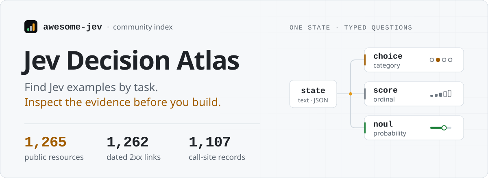
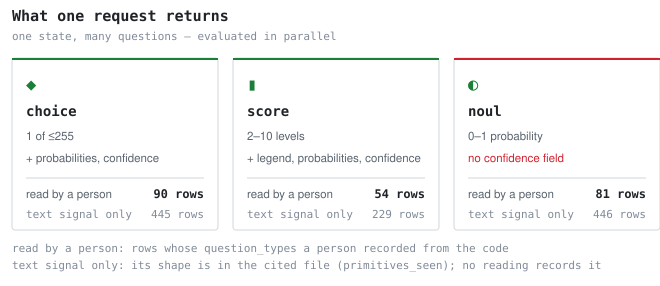
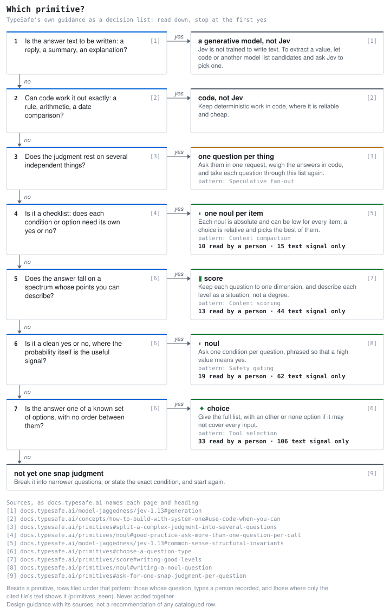
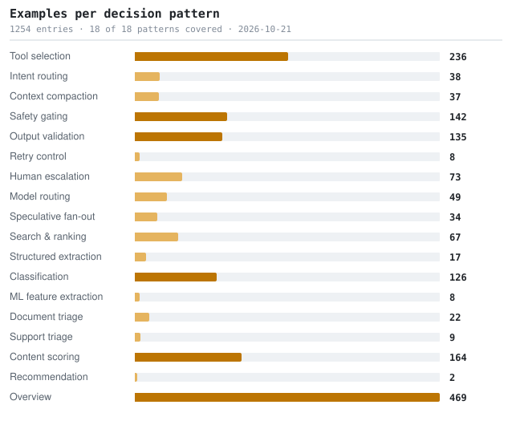

<!--
  This file is generated from catalog.json. Edit the catalog, then run `python3 scripts/build_readme.py`.
-->

<a href="https://kydlikebtc.github.io/awesome-jev/?lang=en">
<picture>
  <source media="(min-width: 768px) and (prefers-color-scheme: light)" srcset="docs/assets/readme-cover-en-light.svg">
  <source media="(max-width: 767px) and (prefers-color-scheme: light)" srcset="docs/assets/readme-cover-en-light-mobile.svg">
  <source media="(max-width: 767px)" srcset="docs/assets/readme-cover-en-dark-mobile.svg">
  <source media="(prefers-color-scheme: dark)" srcset="docs/assets/readme-cover-en-dark.svg">
  
</picture>
</a>

<a href="https://kydlikebtc.github.io/awesome-jev/?lang=en"><kbd>&nbsp;<b>Explore&nbsp;the&nbsp;catalogue&nbsp;↗</b>&nbsp;</kbd></a>
<a href="https://kydlikebtc.github.io/awesome-jev/?collection=first-call&amp;lang=en"><kbd>&nbsp;First&nbsp;call&nbsp;</kbd></a>
<a href="https://kydlikebtc.github.io/awesome-jev/?collection=build&amp;lang=en"><kbd>&nbsp;Adapt&nbsp;a&nbsp;project&nbsp;</kbd></a>
<a href="https://kydlikebtc.github.io/awesome-jev/?collection=measured&amp;lang=en"><kbd>&nbsp;Independent&nbsp;reports&nbsp;</kbd></a>
<a href="README.zh-CN.md"><kbd>&nbsp;中文&nbsp;</kbd></a>

Counts describe saved link and evidence records, not current CI passes or runtime tests. <a href="#what-is-verified-and-what-is-not">About these counts</a>

<b>On this page · full reading map</b>

[Patterns](docs/patterns.md) · [Compatibility](docs/compatibility.md) · [Vetting](docs/vetting.md)

- 01 [What this is](#what-this-is)
- 02 [What Jev returns](#what-jev-returns)
- 03 [Start here](#start-here)
- 04 [Coverage](#coverage)
- 05 [Measured, not claimed](#measured-not-claimed)
- 06 [By decision pattern](#by-decision-pattern)
- 07 [By resource kind](#by-resource-kind)
- 08 [Also in this repo](#also-in-this-repo)
- 09 [What is verified, and what is not](#what-is-verified-and-what-is-not)
- 10 [Machine-readable data](#machine-readable-data)
- 11 [Contributing and licence](#contributing-and-licence)

---

## What this is

- **Jev** is a decision model from TypeSafe AI. It does not write text — you hand it state plus typed questions and it returns typed answers with calibrated confidence, fast and cheap enough to sit in an agent's inner loop.
- **This repo** indexes public examples of using it, organised by the *decision* being made. The resource you read this week is disposable; the decision pattern is not.
- **How to assess it:** every row names its source. Call-site citations, primitive claims and caveats are recorded where available, so you can inspect what was read and what remains untested.

> [!NOTE]
> Not the product, not an SDK, not affiliated with TypeSafe AI, and not a recommendation. Inclusion is a source record, not a runtime or performance endorsement. See [what is verified](#what-is-verified-and-what-is-not).

## What Jev returns

Three core primitives: Choice, Score and Noul. The patterns below use these; Noul returns a probability without a separate confidence field. Jev 1.14 also adds experimental [Box](https://docs.typesafe.ai/primitives/box): one bounding box and confidence per question, with no 'not found' answer. Box requires an image and the images opt-in described below.

<picture>
  <source media="(prefers-color-scheme: dark)" srcset="docs/assets/primitives-en-dark.svg">
  
</picture>

Under each primitive, two counts that are never added together: rows whose `question_types` records a person reading the code call it, and rows where only a text signal shows it — the weekly refresh found its request or answer shape in the one file the row cites (`primitives_seen`), which does not show that the code calls it. See [what is verified](#what-is-verified-and-what-is-not).

Input is text or structured JSON by default. On the native API, Jev 1.13 and 1.14 also accept experimental [PNG/JPEG images](https://docs.typesafe.ai/images) with `TypeSafe-Danger-Zone-Images: true`; audio and video are unsupported. Default context is **64k** tokens per request, **32k** for the state plus the longest question. The experimental `TypeSafe-Danger-Zone-Long-Context: true` header raises both limits to **262k**, with lower speed and accuracy ([models](https://docs.typesafe.ai/models)). Output tokens are free. As checked on 2026-10-15, native `jev-preview` points to `jev-1.14.0` and `jev-latest` still points to `jev-1.13.0`; both pinned IDs are accepted. The [October 14 announcement](https://typesafe.ai/blog/jev-1-14) said latest would move about a week later, without an exact switch date. There are no published weights, so it cannot be run locally. Full cross-platform differences: [`docs/compatibility.md`](docs/compatibility.md).

Which primitive fits a decision? The figure below arranges TypeSafe's own guidance as a decision list: read down and stop at the first yes. The order and the wording are this repository's; every step cites the page it follows, listed under the figure. It is the vendor's design guidance with its sources, not a recommendation of any row here.

<picture>
  <source media="(prefers-color-scheme: dark)" srcset="docs/assets/primitive-picker-en-dark.svg">
  
</picture>

Beside each primitive, the rows filed under the pattern named there, counted as the figure above counts them: read by a person, or text signal only. The steps live in [`picker.json`](picker.json), which the site's primitives view reads too. Sources, numbered as in the figure: [1] [docs.typesafe.ai/model-jaggedness/jev-1.13#generation](https://docs.typesafe.ai/model-jaggedness/jev-1.13#generation) · [2] [docs.typesafe.ai/concepts/how-to-build-with-system-one#use-code-when-you-can](https://docs.typesafe.ai/concepts/how-to-build-with-system-one#use-code-when-you-can) · [3] [docs.typesafe.ai/primitives#split-a-complex-judgment-into-several-questions](https://docs.typesafe.ai/primitives#split-a-complex-judgment-into-several-questions) · [4] [docs.typesafe.ai/primitives/noul#good-practice-ask-more-than-one-question-per-call](https://docs.typesafe.ai/primitives/noul#good-practice-ask-more-than-one-question-per-call) · [5] [docs.typesafe.ai/model-jaggedness/jev-1.13#common-sense-structural-invariants](https://docs.typesafe.ai/model-jaggedness/jev-1.13#common-sense-structural-invariants) · [6] [docs.typesafe.ai/primitives#choose-a-question-type](https://docs.typesafe.ai/primitives#choose-a-question-type) · [7] [docs.typesafe.ai/primitives/score#writing-good-levels](https://docs.typesafe.ai/primitives/score#writing-good-levels) · [8] [docs.typesafe.ai/primitives/noul#writing-a-noul-question](https://docs.typesafe.ai/primitives/noul#writing-a-noul-question) · [9] [docs.typesafe.ai/primitives#ask-for-one-snap-judgment-per-question](https://docs.typesafe.ai/primitives#ask-for-one-snap-judgment-per-question).

## Start here

Six things in reading order. Hand-picked, because "most starred" is not the same as "read this first".

1. **[Quickstart](https://docs.typesafe.ai/introduction/quickstart)**

   The canonical first call: one support ticket, one Choice, one Score and one Noul in a single request, in Python, JS and cURL.

2. **[Jev 1.13 known limitations](https://docs.typesafe.ai/model-jaggedness/jev-1.13)**

   This page is explicitly scoped to Jev 1.13; it does not establish which limitations remain in Jev 1.14. It explains why a Choice over options and one Noul per option answer different questions.

3. **[Example: three primitives in one request](https://github.com/kydlikebtc/awesome-jev/blob/main/examples/01-three-primitives/main.py)**

   Written from the official API reference and checked field by field against it, but not executed against the live API.

4. **[fast-jev-compaction](https://github.com/tamaratran/fast-jev-compaction)**

   Exactly two nouls per tool call: does knowing this call happened still matter, and is the full output still needed verbatim. Despite the word "scored" in its own description, no score primitive is used.

5. **[ai-cookbook: Jev track](https://github.com/daveebbelaar/ai-cookbook)**

   The best structured tutorial found. It states plainly that typed output does not guarantee a correct decision, lists the documented weaknesses, and qualifies its own cost illustration rather than selling it.

6. **[Hermes Agent: Jev compaction evaluation](https://github.com/NousResearch/hermes-agent)**

   The single most credible row in this catalog. Recall came out below their existing summariser, and at a matched context budget it tied plain recency ordering. Cost was genuinely far lower. Publishing a negative result on a hyped model is rare.

## Coverage

Every decision pattern, sized by how many entries this catalogue contains. Use the pattern index below the chart to jump to a section. A zero is a research gap, not a rendering bug.

<picture>
  <source media="(prefers-color-scheme: dark)" srcset="docs/assets/coverage-en-dark.svg">
  
</picture>

All 18 patterns have at least one catalogue entry. Coverage does not imply runtime testing or equal maturity. See [`docs/status.md`](docs/status.md).

**Pattern index · jump to the examples**

| Decision pattern | Decision pattern |
| :--- | :--- |
| [Tool selection](#tool-selection) · **236** | [Intent routing](#intent-routing) · **39** |
| [Context compaction](#context-compaction) · **37** | [Safety gating](#safety-gating) · **142** |
| [Output validation](#output-validation) · **136** | [Retry control](#retry-control) · **8** |
| [Human escalation](#human-escalation) · **73** | [Model routing](#model-routing) · **49** |
| [Speculative fan-out](#speculative-fan-out) · **34** | [Search & ranking](#search--ranking) · **71** |
| [Structured extraction](#structured-extraction) · **18** | [Classification](#classification) · **127** |
| [ML feature extraction](#ml-feature-extraction) · **8** | [Document triage](#document-triage) · **22** |
| [Support triage](#support-triage) · **9** | [Content scoring](#content-scoring) · **165** |
| [Recommendation](#recommendation) · **2** | [Overview](#overview) · **475** |

## Measured, not claimed

Independent measurement reports in the catalogue, including **negative results** that help explain where an approach fails. These are the original authors' measurements; this repository has not independently reproduced them. Check each report's dataset, method and model version before comparing results.

*Author's conclusion* is the direction a benchmark's own author states for Jev on the task they measured (`measurement.direction`: favourable, mixed, unfavourable or inconclusive), indexed from the author's report: author-stated, not reproduced here, and absent where the author states none in words. [docs/benchmarks.md](docs/benchmarks.md) sets every benchmark's measurement side by side.

### Negative results first

Rows whose own author measured Jev for the use and concluded against it: a benchmark whose measurement's direction is *unfavourable*, or another row flagged *measured, not adopted*. Author-stated, not reproduced here. Read them before the positive examples; [the site lists them](https://kydlikebtc.github.io/awesome-jev/?neg=1&lang=en).

- **[Hermes Agent: Jev compaction evaluation](https://github.com/NousResearch/hermes-agent)** 
  Ported the Jev compaction approach, measured it against their shipping summariser, and published the conclusion not to adopt it. 
  `Benchmark` · ★100k+ · `Py` · `noul` · [call site](https://github.com/NousResearch/hermes-agent/blob/HEAD/evals/compaction/jev_arm.py), read 2026-09-22 · author's conclusion: unfavourable (author-stated, not reproduced here)

  > The single most credible row in this catalog. Recall came out below their existing summariser, and at a matched context budget it tied plain recency ordering. Cost was genuinely far lower. Publishing a negative result on a hyped model is rare.

- **[worldmonitor: news threat classification](https://github.com/koala73/worldmonitor)** 
  Two Choice questions over threat level and category, held in shadow mode after a blind evaluation found Jev merely tied the incumbent model. 
  `Benchmark` · ★10k+ · `TS` · `choice` · [call site](https://github.com/koala73/worldmonitor/blob/HEAD/shared/jev-classify.js), read 2026-09-22 · author's conclusion: unfavourable (author-stated, not reproduced here)

  **Caveats:** `shadow mode`

  > Wired in but deliberately inert: by their own statement nothing Jev returns reaches a label, a cache row or an alert. Ships a golden fixture. A model to copy for how to trial a new model without betting production on it.

- **[hermes-jev-skills](https://github.com/kerpopule/hermes-jev-skills)** 
  Nine agent skills plus a CLI covering model routing, memory filtering, turn retention, one-of-many skill selection and next-action choice. 
  `Plugin` · ★1k+ · `Py` · `choice` · `score` · `noul` · [call site](https://github.com/kerpopule/hermes-jev-skills/blob/HEAD/jevkit/client.py), read 2026-09-22

  **Caveats:** `measured, not adopted`

  > Notable for publishing a use it dropped: Jev-summarised handoffs had worse recall than raw transcripts.

- **[no-mistakes: Jev review pre-brief, measured and retired](https://github.com/kunchenguid/no-mistakes/pull/1165)** 
  One Score per candidate file to pre-brief code review — measured twice, then removed: more billed input for essentially no wall-clock gain, and offline replay showed the candidate list could not reach where review findings land. 
  `Benchmark` · ★1k+ · `Go` · `score` · author's conclusion: unfavourable (author-stated, not reproduced here)

  > Removed in PR #1165 (2026-09-22). Their offline measurement found the candidate generator excluded changed files by construction while nearly all review findings sit in changed files, and that per-file excerpts made the list less precise at higher token cost. The code is gone from the default branch, so this row cites the change that removed it.

- **[jev-skill-router](https://github.com/shimo4228/jev-skill-router)** 
  Claude Code hook asking Jev which installed skill fits each prompt: a choice ranks all skills beside three noul gates, then a choice and a noul per skill judge the top three, none suggested under 0.30. Shadow mode only logs; in the author's week, 28 of 539 suggestions were followed by that skill. (written by a model) 
  `Plugin` · ★10+ · shimo4228 · `Py` · [call site](https://github.com/shimo4228/jev-skill-router/blob/HEAD/scripts/jev_client.py), read 2026-09-22

  **Caveats:** `measured, not adopted`

  > Its author ran it on 2026-09-21 and concluded that, as a router, it is unlikely to help a strong model, which already sees every skill's description. Its README: 6 of 6 scripted requests handled sensibly on 0.2.0, 3 of 6 real-session prompts wrong on 0.1.0, which the author calls an anecdote, not a rate. It stays in shadow mode. https://dev.to/shimo4228/i-added-jevs-skill-router-to-claude-code-and-turned-back-just-before-rewriting-the-skill-listing-34in A model wrote this row's Chinese note.

### Other independent reports

- **[An early-access test of TypeSafe's Jev: calibrated judgments for half a cent](https://lindfors.no/blog/a-first-look-at-typesafes-jev/)** 
  The best independent test found: 24 Norwegian documents on one pinned model version, opening with a case the model got wrong while correctly reporting low confidence. 
  `Benchmark` · Lindfors

  > Methodology is stated cleanly and scoped honestly as a single-day snapshot. Leading with a failure case is what makes it a real calibration test rather than a testimonial.

- **[Testing TypeSafe Jev, Mistral and Gemini for local event validation](https://nearhere.events/blog/typesafe-jev-mistral-gemini-event-validation)** 
  The only three-way head-to-head found, with each model's prompt tuned separately and the scope limited to one task rather than a general ranking. 
  `Benchmark` · Near Here

  > Self-limits correctly: a use-case study, not a model leaderboard. That restraint is rarer than the numbers.

- **[hippo-memory](https://github.com/kitfunso/hippo-memory)** 
  Biologically-inspired memory for AI agents. Decay, retrieval strengthening, consolidation. Zero runtime deps, SQLite, MCP. Benchmarked retrieval with an opt-in TypeSafe Jev reranker. 
  `Benchmark` · ★100+ · kitfunso · `TS` · [call site](https://github.com/kitfunso/hippo-memory/blob/HEAD/src/rerankers/jev.ts), read 2026-09-22 · author's conclusion: mixed (author-stated, not reproduced here)

- **[jev-arena](https://github.com/NanmiCoder/jev-arena)** 
  An introduction to Jev with hands-on tests: Choice, Score and Noul turn natural language into typed judgements for classification, scoring and routing, compared with DeepSeek on comment labelling, speed and results, with CSV import, replay and offline reports. 
  `Benchmark` · ★100+ · nanmicoder · `JS` · [call site](https://github.com/NanmiCoder/jev-arena/blob/HEAD/src/backends/jev.mjs), read 2026-09-24

- **[jevbench](https://github.com/fstandhartinger/jevbench)** 
  Benchmark Heaven's benchmark for Jev and Jev-compatible decision models: noul, choice and score tasks, sent through a /v1/systemone adapter and scored for accuracy, calibration, latency and cost. Release v1.6.1 (2026-10-06); some inputs are sealed, so it cannot be fully rerun independently. (written by a model) 
  `Benchmark` · ★100+ · fstandhartinger · `Py` · [call site](https://github.com/fstandhartinger/jevbench/blob/HEAD/jevbench/adapters/typesafe.py), read 2026-09-22

**10 of 74** shown: the negative results first, then the picks of the curated [independent reports](https://kydlikebtc.github.io/awesome-jev/?collection=measured&lang=en) path, in its order, then the first of the others in list order · [all 74 on one page, with every note →](docs/measured.md) · [filter on the site](https://kydlikebtc.github.io/awesome-jev/?indep=1&lang=en)

## By decision pattern

The primary index. Each heading is a decision an agent has to make; the rows are examples of making it. Caveats appear as short tags — the full note for each row is in [`catalog.json`](catalog.json) and on [the site](https://kydlikebtc.github.io/awesome-jev/).

★ gives a repository's GitHub stars as a band — ★10+, ★100+, ★1k+, ★10k+ and ★100k+; rows with no repository or under 10 stars show no band. Rows run official first, then with code, then by band, then by title. A band is a popularity signal, not a quality verdict; the exact count, as last read from GitHub, is in [`catalog.json`](catalog.json) and on [the site](https://kydlikebtc.github.io/awesome-jev/?lang=en).

A *call site* link opens the one file a row cites (`evidence.path`) at `HEAD` of the repository's default branch; the date after it is the day a person last read that file (`evidence.read_on`) or, where it says *read by a model*, the day a model did (`evidence.model_read_on`): a reading, not a run of the code. A *cited file* link is the same for a file that shows the project speaking Jev's request shape rather than building on Jev, or only an example it ships (`evidence.kind`). Neither is pinned to a commit, so it opens the file as it is now, which may differ from what was read, and stops resolving once the file moves; the weekly claims check reports that.

### Tool selection

_Which tool or action the agent should call next._

- **[Cookbook: Function calling](https://docs.typesafe.ai/cookbooks/function_calling)** ⭐ 
  Maps natural-language trading requests onto ordinary typed functions by turning function names and closed-set arguments into confidence-aware questions. 
  `Official docs` · `Py` · `choice`

- **[Cookbook: Skill suggestion](https://docs.typesafe.ai/cookbooks/skill_suggestion)** ⭐ 
  Picks at most one skill out of 182 for an agent turn: one request ranks every skill and asks whether the turn needs one at all, a second reads the top three. 
  `Official docs` · `Py` · `choice` · `noul`

- **[Demo: Smart home assistant](https://docs.typesafe.ai/demos/smart-home)** ⭐ 
  Runnable demo code for a smart home assistant that evaluates user requests with typed decisions. 
  `Official docs` · `Py`

- **[ai-hedge-fund](https://github.com/virattt/ai-hedge-fund)** 
  Educational paper-trading and backtesting app whose investor-persona agents turn a financial snapshot into a bullish, bearish or neutral signal. With TypeSafe as provider, one Jev request per agent asks a choice of direction and a five-level score of each case's strength, mapped to the agents' JSON. (written by a model) 
  `Integration` · ★10k+ · virattt · `Py` · [call site](https://github.com/virattt/ai-hedge-fund/blob/HEAD/hedge_fund/llm/client.py), read 2026-09-24

- **[claude-code-templates: three Jev plugins](https://github.com/davila7/claude-code-templates)** 
  Three independently installable Claude Code plugins — guardrails, model router and skill suggestion — each with its own hooks and tests. 
  `Plugin` · ★10k+ · `Py` · `TS` · `choice` · `score` · `noul` · [call site](https://github.com/davila7/claude-code-templates/blob/HEAD/scripts/jev-spike.mjs), read 2026-09-22

- **[Composio TypeSafe provider](https://github.com/ComposioHQ/composio/tree/next/python/providers/typesafe)** 
  Compiles a tool catalogue into questions and reconstructs tool calls from the answers, with typed errors for abstention and confirmation-required cases. 
  `Project` · ★10k+ · `Py` · `choice` · [call site](https://github.com/ComposioHQ/composio/blob/HEAD/python/providers/typesafe/composio_typesafe/provider.py), read 2026-09-22

- **[Cua driver: jev-use example](https://github.com/trycua/cua/tree/main/libs/cua-driver/examples/jev-use)** 
  Computer-use action selection in Python and TypeScript: Jev picks the next browser action from an immutable candidate set, with reobserve and abstain as reserved options. 
  `Project` · ★10k+ · `Py` · `TS` · `choice` · [call site](https://github.com/trycua/cua/blob/HEAD/libs/cua-driver/examples/jev-use/python/jev_adapter.py), read 2026-09-22

- **[FastMCP jev_search transform](https://github.com/PrefectHQ/fastmcp/blob/main/fastmcp_slim/fastmcp/experimental/transforms/jev_search.py)** 
  Two-stage MCP tool search: a wide Choice coarse-ranks the whole catalogue, then a shortlist gets full descriptions plus one Noul each to decide whether it does the job at all. 
  `Project` · ★10k+ · `Py` · `choice` · `noul` · [call site](https://github.com/PrefectHQ/fastmcp/blob/HEAD/fastmcp_slim/fastmcp/experimental/transforms/jev_search.py), read 2026-09-22

- **[jev-ultrafast](https://github.com/browser-use/jev-ultrafast)** 
  A high-speed browser agent from Browser Use: Jev decides the operation and which element to act on, and a small LLM is called only when text must be typed. 
  `Project` · ★10k+ · Browser Use · `Py` · `choice` · [call site](https://github.com/browser-use/jev-ultrafast/blob/HEAD/jev_ultrafast/model.py), read 2026-09-22

  **Caveats:** `vendor numbers`

- **[json-render](https://github.com/vercel-labs/json-render)** 
  Vercel Labs' generative UI framework. In its Jev experiment the model does not write JSON token by token — it only picks components, props and layout. 
  `Project` · ★10k+ · Vercel Labs · `TS` · `choice` · [call site](https://github.com/vercel-labs/json-render/blob/HEAD/apps/web/lib/jev/compose.ts), read 2026-09-22

**10 of 236** shown · [all 236 on one page →](docs/by-pattern/tool-selection.md) · [filter on the site](https://kydlikebtc.github.io/awesome-jev/?p=tool-selection&lang=en)

[↑ Pattern index](#pattern-index)

### Intent routing

_Classify what the user wants and send the request down the right branch._

- **[Demo: Smart home assistant](https://docs.typesafe.ai/demos/smart-home)** ⭐ 
  Runnable demo code for a smart home assistant that evaluates user requests with typed decisions. 
  `Official docs` · `Py`

- **[Pattern: Confidence-gated routing](https://docs.typesafe.ai/patterns/confidence-routing)** ⭐ 
  Treat confidence as a second axis: the answer tells you what, the confidence tells you whether to act on it. 
  `Official docs` · `Py`

- **[Pattern: Intent routing](https://docs.typesafe.ai/patterns/intent-routing)** ⭐ 
  Classify an incoming request and route it to the cheapest adequate handler: deterministic code, a specialist LLM, or a person. 
  `Official docs` · `Py` · `choice`

- **[AutoGPT TypeSafe blocks](https://github.com/Significant-Gravitas/AutoGPT/tree/master/autogpt_platform/backend/backend/blocks/typesafe)** 
  Seven production blocks — choice, score, yes/no, ask-many, route, pick-best, filter — with a UTF-8 byte budget, verbatim wire capture and eleven test files. 
  `Project` · ★100k+ · `Py` · `choice` · `score` · `noul` · [call site](https://github.com/Significant-Gravitas/AutoGPT/blob/HEAD/autogpt_platform/backend/backend/blocks/typesafe/_client.py), read 2026-09-22

- **[Airflow LLMBranchOperator with Jev](https://airflow.apache.org/docs/apache-airflow-providers-common-ai/stable/index.html)** 
  Turns downstream task ids into a choice option set, with a minimum-confidence gate that routes uncertain runs to a human. 
  `Integration` · ★10k+ · `Py` · `choice`

- **[Inbox Zero: seven email decisions](https://github.com/elie222/inbox-zero)** 
  Seven distinct email decisions, each with its own separately chosen threshold, falling back to the normal LLM on any error. 
  `Project` · ★10k+ · `TS` · `choice` · `noul` · [call site](https://github.com/elie222/inbox-zero/blob/HEAD/apps/web/utils/decision-model/typesafe.ts), read 2026-09-22

- **[ai-cookbook: Jev track](https://github.com/daveebbelaar/ai-cookbook)** 
  A graded course from a first call through each primitive, state shapes and criteria, to ticket triage and a multi-step workflow, mirroring all four official patterns. 
  `Tutorial` · ★1k+ · `Py` · `choice` · `score` · `noul` · [call site](https://github.com/daveebbelaar/ai-cookbook/blob/HEAD/models/jev/06-criteria.py), read 2026-09-22

- **[jev-chat-jarvis](https://github.com/jev-chat/jev-chat-jarvis)** 
  An Android reply co-pilot that judges intent, timing and risk from on-screen text, while separate models handle OCR and drafting. 
  `Project` · ★1k+ · `Java` · `choice` · `score` · `noul` · [call site](https://github.com/jev-chat/jev-chat-jarvis/blob/HEAD/app/src/main/java/com/jev/probe/jev/JevQuestions.kt), read 2026-09-22

- **[Real Python: hello-jev](https://github.com/realpython/materials/tree/master/hello-jev)** 
  A teaching example with a deliberate control group: the same station-enquiry task written in plain Python that only accepts Y/N, next to a Noul that reads intent. 
  `Tutorial` · ★1k+ · Real Python · `Py` · `noul` · [call site](https://github.com/realpython/materials/blob/HEAD/hello-jev/jev_noul.py), read 2026-09-22

- **[shapeshift](https://github.com/anishfn/shapeshift)** 
  One text box that turns into the right card as you type (event, checklist, timer, bill split and more). With a TypeSafe key one Jev call answers 14 questions: which card, plus choices, nouls and scores such as urgency or video call; code parses dates and amounts. Offline, keyword rules answer. (written by a model) 
  `Project` · ★1k+ · anishfn · `TS` · [call site](https://github.com/anishfn/shapeshift/blob/HEAD/src/lib/jev/client.ts), read 2026-09-24

**10 of 39** shown · [all 39 on one page →](docs/by-pattern/intent-routing.md) · [filter on the site](https://kydlikebtc.github.io/awesome-jev/?p=intent-routing&lang=en)

[↑ Pattern index](#pattern-index)

### Context compaction

_Decide which tool calls and results still matter so stale context can be dropped._

- **[Hermes Agent: Jev compaction evaluation](https://github.com/NousResearch/hermes-agent)** 
  Ported the Jev compaction approach, measured it against their shipping summariser, and published the conclusion not to adopt it. 
  `Benchmark` · ★100k+ · `Py` · `noul` · [call site](https://github.com/NousResearch/hermes-agent/blob/HEAD/evals/compaction/jev_arm.py), read 2026-09-22 · author's conclusion: unfavourable (author-stated, not reproduced here)

- **[jcode: memory recall without embeddings](https://github.com/1jehuang/jcode)** 
  Replaces the whole retrieval stack for memory recall — no embeddings, no BM25, no reranker — with one batched Noul per candidate memory. 
  `Project` · ★10k+ · `Rs` · `noul` · [call site](https://github.com/1jehuang/jcode/blob/HEAD/crates/jcode-base/src/jev.rs), read 2026-09-22

- **[fast-jev-compaction](https://github.com/tamaratran/fast-jev-compaction)** 
  A Claude Code plugin that replaces the compaction summary with per-item decisions: stale tool calls are dropped or truncated, everything kept stays verbatim. 
  `Plugin` · ★1k+ · tamaratran · `TS` · `noul` · [call site](https://github.com/tamaratran/fast-jev-compaction/blob/HEAD/src/request.ts), read 2026-09-22

- **[hermes-jev-skills](https://github.com/kerpopule/hermes-jev-skills)** 
  Nine agent skills plus a CLI covering model routing, memory filtering, turn retention, one-of-many skill selection and next-action choice. 
  `Plugin` · ★1k+ · `Py` · `choice` · `score` · `noul` · [call site](https://github.com/kerpopule/hermes-jev-skills/blob/HEAD/jevkit/client.py), read 2026-09-22

  **Caveats:** `measured, not adopted`

- **[compact-adviser](https://github.com/kunchenguid/compact-adviser)** 
  Plugin answering one question, should I /compact now: one Jev request asks two choices (is the latest unit of work finished; hands-on or coordination), combined in code into a score whose floor relaxes from 0.90 to 0.50 as the context fills. It hints, or compacts on Pi and Claude Code if you opt in. (written by a model) 
  `Project` · ★100+ · kunchenguid · `TS` · [call site](https://github.com/kunchenguid/compact-adviser/blob/HEAD/packages/claude-mod/lib/judge.ts), read 2026-09-22

- **[jev-pruner](https://github.com/tamaratran/jev-pruner)** 
  Trims long shell output before the model sees it, asking one Noul per chunk. 
  `Plugin` · ★100+ · tamaratran · `TS` · `noul` · [call site](https://github.com/tamaratran/jev-pruner/blob/HEAD/src/jev.ts), read 2026-09-22

- **[mu](https://github.com/qybaihe/mu)** 
  Coding agent and desktop app built on pi that asks Jev at 38 decision points which tool-output chunks enter the context, which stale tool results to drop, whether a rule-flagged command was asked for and whether fetched pages or MCP output carry injected instructions. 
  `Project` · ★100+ · qybaihe · `TS` · `choice` · `noul` · `score` · [call site](https://github.com/qybaihe/mu/blob/HEAD/packages/kyrn-judge/src/providers/typesafe.ts)

  **Caveats:** `self-submitted`

- **[Winnow](https://github.com/GhalebDweikat/winnow)** 
  Context garbage collection for Claude Code: when Read, Bash or Grep dump a wall of output, each chunk is judged for relevance to the current task. 
  `Plugin` · ★100+ · `Py` · `noul` · [call site](https://github.com/GhalebDweikat/winnow/blob/HEAD/sidecar/src/winnow/judge.py), read 2026-09-22

- **[claude-jev](https://github.com/0x7067/claude-jev)** 
  Claude Code and Pi plugin that sends small judgments to Jev: whether an edit breaks a rule in CLAUDE.md (blocked with a file:line citation), which context blocks to keep verbatim at compaction, a model tier per subagent with nouls on its brief, and a routing hint per prompt. Every hook fails open. (written by a model) 
  `Plugin` · ★10+ · 0x7067 · `Py` · [call site](https://github.com/0x7067/claude-jev/blob/HEAD/scripts/jev.py), read 2026-09-22

- **[dsh-jev-tools](https://github.com/HorusJiang/dsh-jev-tools)** 
  DeepSeek Harness plugin asking Jev, before tool output enters the context, which segments of a long read or fetch matter (kept by rank, not threshold), whether a fetched page holds instructions aimed at an AI (warned at 0.75, left unchanged), which skill to suggest, and if a done claim has evidence. (written by a model) 
  `Plugin` · ★10+ · horusjiang · `TS` · [call site](https://github.com/HorusJiang/dsh-jev-tools/blob/HEAD/src/config.ts), read 2026-09-24

**10 of 37** shown · [all 37 on one page →](docs/by-pattern/context-compaction.md) · [filter on the site](https://kydlikebtc.github.io/awesome-jev/?p=context-compaction&lang=en)

[↑ Pattern index](#pattern-index)

### Safety gating

_Decide whether an action is safe to run. Defence in depth, never a security boundary._

- **[Cookbook: Classifying RAG passages](https://docs.typesafe.ai/cookbooks/classifying_rag_passages)** ⭐ 
  Scores each retrieved passage, then decides in code which reach the answering model — keeping contradictory ones flagged and dropping ones carrying prompt injection. 
  `Official docs` · `Py`

- **[Cookbook: Guardrails for LLMs](https://docs.typesafe.ai/cookbooks/llm_guardrails)** ⭐ 
  Screens every message in and out of an LLM app in one request, naming hazards and scoring how much harm complying would do. 
  `Official docs` · `Py` · `noul` · `score`

- **[@langchain/typesafe](https://github.com/langchain-ai/langchainjs)** 
  The JavaScript counterpart of the LangChain integration, with the same classifier and middleware shapes. 
  `Integration` · ★10k+ · `TS` · `choice` · `score` · `noul` · [call site](https://github.com/langchain-ai/langchainjs/blob/HEAD/libs/providers/langchain-typesafe/src/types.ts), read 2026-09-22

- **[claude-code-templates: three Jev plugins](https://github.com/davila7/claude-code-templates)** 
  Three independently installable Claude Code plugins — guardrails, model router and skill suggestion — each with its own hooks and tests. 
  `Plugin` · ★10k+ · `Py` · `TS` · `choice` · `score` · `noul` · [call site](https://github.com/davila7/claude-code-templates/blob/HEAD/scripts/jev-spike.mjs), read 2026-09-22

- **[sub2api: Jev as a moderation endpoint](https://github.com/Wei-Shaw/sub2api)** 
  Drops in as a moderation API by asking many parallel Noul questions in one request, one per hazard category, with an anti-injection prefix on every instruction. 
  `Project` · ★10k+ · `Go` · `noul` · [call site](https://github.com/Wei-Shaw/sub2api/blob/HEAD/backend/internal/pkg/typesafe/client.go), read 2026-09-22

- **[agentgateway: CI-validated LLM guardrail](https://github.com/agentgateway/agentgateway)** 
  Three Score questions on a shared severity scale, blocking the request when two or more cross the line, and failing closed. 
  `Project` · ★1k+ · `Rs` · `score` · [call site](https://github.com/agentgateway/agentgateway/blob/HEAD/examples/llm-guardrail-jev/guardrail.ts), read 2026-09-22

- **[DeepChat: agent tool-permission review](https://github.com/ThinkInAIXYZ/deepchat)** 
  Reviews each tool call on three axes — risk level, whether the user authorised it, and an explicit prompt-injection pressure check. 
  `Project` · ★1k+ · `TS` · `choice` · `noul` · [call site](https://github.com/ThinkInAIXYZ/deepchat/blob/HEAD/src/shared/jevProtocol.ts), read 2026-09-22

- **[atomic](https://github.com/bastani-inc/atomic)** 
  Coding-agent runtime in which workflows are versioned TypeScript stages with executable checks, review gates and human approvals. Its AI package lists Jev from models.dev as a System One decision model on five providers, apart from the chat models; the README does not say where a workflow calls it. (written by a model) 
  `Project` · ★100+ · bastani-inc · `TS` · [call site](https://github.com/bastani-inc/atomic/blob/HEAD/packages/ai/src/decision-models.generated.ts), read 2026-09-24

- **[grok-bot-jev](https://github.com/Bodila51/grok-bot-jev)** 
  Router for Grok Bot that asks Jev, before research, browsing, retries or subagents, which action a request needs: reuse a cached artifact, stop a failing retry, run deterministic code, cap research, allow a subagent or ask a person. Shadow mode only logs; active mode relies on a pasted skill. (written by a model) 
  `Plugin` · ★100+ · bodila51 · `Py` · [call site](https://github.com/Bodila51/grok-bot-jev/blob/HEAD/src/jev_client.py), read 2026-09-22

- **[Jev-cu](https://github.com/Sac-Y/Jev-cu)** 
  A computer-use agent that asks which accessibility-tree element to act on, plus a separate noul for whether the action needs explicit user confirmation. 
  `Project` · ★100+ · `JS` · `choice` · `noul` · [call site](https://github.com/Sac-Y/Jev-cu/blob/HEAD/scripts/jev-decide.mjs), read 2026-09-22

**10 of 142** shown · [all 142 on one page →](docs/by-pattern/safety-gating.md) · [filter on the site](https://kydlikebtc.github.io/awesome-jev/?p=safety-gating&lang=en)

[↑ Pattern index](#pattern-index)

### Output validation

_Check a model's output against a rubric before it reaches a user._

- **[Cookbook: Double-checking citations](https://docs.typesafe.ai/cookbooks/citation_check)** ⭐ 
  Catches wrong or invented citations against the source document with one Choice, using its confidence to flag borderline cases for review. 
  `Official docs` · `Py` · `choice`

- **[Cookbook: Guardrails for LLMs](https://docs.typesafe.ai/cookbooks/llm_guardrails)** ⭐ 
  Screens every message in and out of an LLM app in one request, naming hazards and scoring how much harm complying would do. 
  `Official docs` · `Py` · `noul` · `score`

- **[latitude-llm](https://github.com/latitude-dev/latitude-llm)** 
  Open-source observability for AI agents that flags where agents fail in their traces. A shadow provider asks Jev one noul per flagger dimension, at most 11 per call; the cited file does not show whether those answers change any flag, and the README does not mention Jev. (written by a model) 
  `Project` · ★1k+ · latitude-dev · `TS` · [call site](https://github.com/latitude-dev/latitude-llm/blob/HEAD/packages/platform/ai-jev/src/jev-shadow-decision-provider.ts), read 2026-09-22

- **[reticle](https://github.com/reticlehq/reticle)** 
  Checks an agent's "done" by driving the running app and returning pass, fail or cannot tell. Its benchmark harness asks Jev, in one call on captured evidence, five nouls (did the intended consequence happen, is the capture clean, did the app error), a pass/fail/unknown choice and a severity score. (written by a model) 
  `Project` · ★1k+ · reticlehq · `TS` · [call site](https://github.com/reticlehq/reticle/blob/HEAD/bench/harness/jev.mjs), read 2026-09-24

- **[abide](https://github.com/coldteadotai/abide)** 
  Hooks into Claude Code, Codex, OpenCode and Pi and, on every edit or turn, asks Jev one yes-or-no question per rule in AGENTS.md or CLAUDE.md, showing only the rule and the diff; a broken rule goes back to the agent to fix. On 93 replayed sessions Jev flagged 39 edits; a reviewer confirmed 10. (written by a model) 
  `Plugin` · ★100+ · coldteadotai · `TS` · [call site](https://github.com/coldteadotai/abide/blob/HEAD/packages/cli/src/lib/jev.ts), read 2026-09-24

- **[atomic](https://github.com/bastani-inc/atomic)** 
  Coding-agent runtime in which workflows are versioned TypeScript stages with executable checks, review gates and human approvals. Its AI package lists Jev from models.dev as a System One decision model on five providers, apart from the chat models; the README does not say where a workflow calls it. (written by a model) 
  `Project` · ★100+ · bastani-inc · `TS` · [call site](https://github.com/bastani-inc/atomic/blob/HEAD/packages/ai/src/decision-models.generated.ts), read 2026-09-24

- **[Canny](https://github.com/qkal/Canny)** 
  Guards against a coding agent claiming it finished: reads tool output, the diff and test results, then judges whether the completion claim holds. 
  `Project` · ★100+ · `TS` · `noul` · `score` · [call site](https://github.com/qkal/Canny/blob/HEAD/src/jev.ts), read 2026-09-22

- **[fastbrowse](https://github.com/agent-labs-dev/fastbrowse)** 
  Browser agent: each page is indexed into candidate controls and Jev chooses the next one, so it cannot click what is not there; a Gemini Flash LLM plans and reads, and answers cite the page. Its maintainer recorded 99.2% on 46 tasks against 97.8% for hosted Browser Use, at under a tenth of the cost. (written by a model) 
  `Project` · ★100+ · agent-labs-dev · `Py` · [call site](https://github.com/agent-labs-dev/fastbrowse/blob/HEAD/src/fastbrowse/clients/typesafe.py), read 2026-09-22

- **[formanator](https://github.com/timrogers/formanator)** 
  Submits Forma benefit claims from the command line or an MCP client. With --category-provider jev, Jev picks the benefit and category with a choice over the pairs Forma allows plus no_match, seeing only merchant and description; under 0.5 confidence or no match it falls back to the configured LLM. (written by a model) 
  `Plugin` · ★100+ · timrogers · `Rs` · [call site](https://github.com/timrogers/formanator/blob/HEAD/src/typesafe.rs), read 2026-09-22

- **[jev-eval-agent](https://github.com/vinilana/jev-eval-agent)** 
  An agent that routes evaluation work through typed decisions. 
  `Project` · ★100+ · vinilana · `TS` · [call site](https://github.com/vinilana/jev-eval-agent/blob/HEAD/agent/lib/jev-router.ts), read 2026-09-22

  **Caveats:** `no licence`

**10 of 136** shown · [all 136 on one page →](docs/by-pattern/output-validation.md) · [filter on the site](https://kydlikebtc.github.io/awesome-jev/?p=output-validation&lang=en)

[↑ Pattern index](#pattern-index)

### Retry control

_Decide whether a failed step is worth retrying._

- **[jev-harness](https://github.com/ismaelsoilet/jev-harness)** 
  Decision gates for AI coding agents (CLI, MCP server, CI hook; Python, TypeScript and Rust SDKs): offline heuristics first, then optional Jev judgments on whether a failing test log needs the LLM, whether to abort a fix loop, which model tier and reasoning effort to use, and if a step is done. (written by a model) 
  `Plugin` · ★10+ · ismaelsoilet · `Py` · [call site](https://github.com/ismaelsoilet/jev-harness/blob/HEAD/src/jev_harness/client.py), read 2026-09-24

- **[DuoMind](https://github.com/j1s4nn/duomind)** 
  OpenAI-compatible local server that pairs a small llama.cpp model with Jev: 18 decision points before, during and after generation (needs reasoning, safety, format, should stop, needs retry) steer the local model. Prompts go to TypeSafe; generation stays local. (written by a model) 
  `Project` · j1s4nn · `Py` · `noul` · `choice` · [call site](https://github.com/j1s4nn/duomind/blob/HEAD/src/duomind/jev_client.py), read by a model 2026-10-24

  **Caveats:** `vendor numbers`

- **[harnessjudge](https://github.com/ndolinschi/harnessjudge)** 
  Web app for agent builders: paste the trace of one agent step and Jev judges it as ok, retry, escalate or stop. Without a TYPESAFE_API_KEY, local heuristics return answers of the same shape, labelled as demo mode. (written by a model) 
  `Project` · ndolinschi · `TS` · [call site](https://github.com/ndolinschi/harnessjudge/blob/HEAD/src/lib/jev.ts), read 2026-09-22

  **Caveats:** `one commit` · `no licence`

- **[Jev by Example](https://github.com/ReallyArtificial/jev-by-example)** 
  Ten runnable JavaScript agent decisions, one file each: reconciling a new memory against a stored one, gating whether an HTTP 200 really satisfied the task, retry vs. reconcile after an uncertain write, scoring context against a budget, checking a handoff for dropped prohibitions. 
  `Project` · Really Artificial · `JS` · `choice` · `score` · `noul` · [call site](https://github.com/ReallyArtificial/jev-by-example/blob/HEAD/src/client.mjs), read 2026-09-22

  **Caveats:** `AI-written`

- **[jev-reasoning-navigator](https://github.com/AndreuVM/praxeon)** 
  JEV Reasoning Navigator: Cognitive supervision, loop prevention, and anti-hallucination engine for autonomous LLM agents using TypeSafe AI 
  `Project` · andreuvm · `Py` · [call site](https://github.com/AndreuVM/praxeon/blob/HEAD/jev_navigator/core/typesafe_client.py), read 2026-09-24

  **Caveats:** `no licence`

- **[jev-resilience](https://github.com/Vicente-MD/jev-resilience)** 
  Spring Boot starter for WebFlux: methods marked @SemanticCircuitBreaker send each response body to Jev with a noul on whether an HTTP 200 hides an error, a stack trace or a maintenance notice; above the threshold (0.85 in its example) it raises an exception a circuit breaker can count. Fails open. (written by a model) 
  `Plugin` · vicente-md · `Java` · [call site](https://github.com/Vicente-MD/jev-resilience/blob/HEAD/src/main/java/ai/jev/resilience/client/dto/JevRequest.java), read 2026-09-22

  **Caveats:** `no licence`

- **[jevswiftsdk](https://github.com/NSStudent/JevSwiftSDK)** 
  Independent, unofficial and dependency-free Swift SDK for the System One API: choice, noul and score questions typed as Swift values, such as a choice over an enum, named batches answered in one call with every answer checked, retries with a policy and cancellation. iOS 15+, macOS 12+ and Linux. (written by a model) 
  `SDK` · nsstudent · `Swift` · [call site](https://github.com/NSStudent/JevSwiftSDK/blob/HEAD/Sources/JevSwiftSDK/Configuration.swift), read 2026-09-22

- **[XavierJev](https://github.com/liu-x27/XavierJev)** 
  A local decision layer in Jev's shape: yes/no, choice and rubric questions read off one token's logprobs from a local model, with a Claude Code permission gate measured on held-out command sets. 
  `Jev-like alternative` · Xinyu Liu · `TS` · `noul` · `choice` · `score` · [cited file](https://github.com/liu-x27/XavierJev/blob/HEAD/src/gate.ts), read 2026-09-25

  **Caveats:** `not Jev itself` · `AI-written`

All 8 shown · [on its own page](docs/by-pattern/retry-control.md) · [filter on the site](https://kydlikebtc.github.io/awesome-jev/?p=retry-control&lang=en)

[↑ Pattern index](#pattern-index)

### Human escalation

_Use calibrated confidence to decide what a person must see._

- **[Cookbook: Classification using confidence](https://docs.typesafe.ai/cookbooks/classification_using_confidence)** ⭐ 
  Classifies annual reports into 75 industry groups, then reads the answer's own confidence to decide whether to report that group or the broader division above it. 
  `Official docs` · `Py` · `choice`

- **[Cookbook: Double-checking citations](https://docs.typesafe.ai/cookbooks/citation_check)** ⭐ 
  Catches wrong or invented citations against the source document with one Choice, using its confidence to flag borderline cases for review. 
  `Official docs` · `Py` · `choice`

- **[Cookbook: Knowledge graph entity alignment](https://docs.typesafe.ai/cookbooks/entity_alignment)** ⭐ 
  Decides which of 450 candidate pairs from two product catalogues describe the same thing, with one Score whose three levels are the three available actions. 
  `Official docs` · `Py` · `score`

- **[Cookbook: Self-consistency with choices](https://docs.typesafe.ai/cookbooks/consistency_choice_cookbook)** ⭐ 
  Adds an explicit "uncertain" outcome to moderation decisions and measures label agreement against the share of actions taken automatically. 
  `Official docs` · `Py` · `choice`

- **[Cookbook: Self-consistency with nouls](https://docs.typesafe.ai/cookbooks/consistency_noul_cookbook)** ⭐ 
  Routes uncertain probabilities to human review while keeping the underlying noul values visible rather than collapsing them to a label. 
  `Official docs` · `Py` · `noul`

- **[Pattern: Confidence-gated routing](https://docs.typesafe.ai/patterns/confidence-routing)** ⭐ 
  Treat confidence as a second axis: the answer tells you what, the confidence tells you whether to act on it. 
  `Official docs` · `Py`

- **[Confidence](https://docs.typesafe.ai/confidence)** ⭐ 
  How Choice and Score confidence is derived from probabilities, how Noul differs, and how to tune thresholds for the question and application. 
  `Official docs`

- **[Airflow LLMBranchOperator with Jev](https://airflow.apache.org/docs/apache-airflow-providers-common-ai/stable/index.html)** 
  Turns downstream task ids into a choice option set, with a minimum-confidence gate that routes uncertain runs to a human. 
  `Integration` · ★10k+ · `Py` · `choice`

- **[Composio TypeSafe provider](https://github.com/ComposioHQ/composio/tree/next/python/providers/typesafe)** 
  Compiles a tool catalogue into questions and reconstructs tool calls from the answers, with typed errors for abstention and confirmation-required cases. 
  `Project` · ★10k+ · `Py` · `choice` · [call site](https://github.com/ComposioHQ/composio/blob/HEAD/python/providers/typesafe/composio_typesafe/provider.py), read 2026-09-22

- **[Inbox Zero: seven email decisions](https://github.com/elie222/inbox-zero)** 
  Seven distinct email decisions, each with its own separately chosen threshold, falling back to the normal LLM on any error. 
  `Project` · ★10k+ · `TS` · `choice` · `noul` · [call site](https://github.com/elie222/inbox-zero/blob/HEAD/apps/web/utils/decision-model/typesafe.ts), read 2026-09-22

**10 of 73** shown · [all 73 on one page →](docs/by-pattern/human-escalation.md) · [filter on the site](https://kydlikebtc.github.io/awesome-jev/?p=human-escalation&lang=en)

[↑ Pattern index](#pattern-index)

### Model routing

_Pick which downstream model or tier should handle a request._

- **[Cookbook: Structured data extraction cascade](https://docs.typesafe.ai/cookbooks/sde_cascade)** ⭐ 
  A two-stage mini-then-verify-then-reasoning cascade that reaches most of a big reasoning model's quality at a fraction of the cost. 
  `Official docs` · `Py`

- **[Pattern: Intent routing](https://docs.typesafe.ai/patterns/intent-routing)** ⭐ 
  Classify an incoming request and route it to the cheapest adequate handler: deterministic code, a specialist LLM, or a person. 
  `Official docs` · `Py` · `choice`

- **[@langchain/typesafe](https://github.com/langchain-ai/langchainjs)** 
  The JavaScript counterpart of the LangChain integration, with the same classifier and middleware shapes. 
  `Integration` · ★10k+ · `TS` · `choice` · `score` · `noul` · [call site](https://github.com/langchain-ai/langchainjs/blob/HEAD/libs/providers/langchain-typesafe/src/types.ts), read 2026-09-22

- **[claude-code-templates: three Jev plugins](https://github.com/davila7/claude-code-templates)** 
  Three independently installable Claude Code plugins — guardrails, model router and skill suggestion — each with its own hooks and tests. 
  `Plugin` · ★10k+ · `Py` · `TS` · `choice` · `score` · `noul` · [call site](https://github.com/davila7/claude-code-templates/blob/HEAD/scripts/jev-spike.mjs), read 2026-09-22

- **[hermes-jev-skills](https://github.com/kerpopule/hermes-jev-skills)** 
  Nine agent skills plus a CLI covering model routing, memory filtering, turn retention, one-of-many skill selection and next-action choice. 
  `Plugin` · ★1k+ · `Py` · `choice` · `score` · `noul` · [call site](https://github.com/kerpopule/hermes-jev-skills/blob/HEAD/jevkit/client.py), read 2026-09-22

  **Caveats:** `measured, not adopted`

- **[Astra-Ares](https://github.com/miuuyy/Astra-Ares)** 
  Runs a patched Codex CLI in which Jev reads bounded task context and, with two choices, picks the reasoning effort for GPT-6's next response and how many responses (1, 2, 5 or 10) it should last; GPT-6 can change effort without breaking the prompt cache. An experimental reference implementation. (written by a model) 
  `Plugin` · ★100+ · miuuyy · `JS` · [call site](https://github.com/miuuyy/Astra-Ares/blob/HEAD/src/jev.mjs), read 2026-09-24

- **[jev-codex-router](https://github.com/0xNatoshi/jev-codex-router)** 
  Judges how hard a coding turn is, then picks the model tier, reasoning depth and speed mode to match. 
  `Plugin` · ★100+ · `JS` · `choice` · `score` · [call site](https://github.com/0xNatoshi/jev-codex-router/blob/HEAD/server/jev_server.py), read 2026-09-22

  **Caveats:** `archived`

- **[jev-eval-agent](https://github.com/vinilana/jev-eval-agent)** 
  An agent that routes evaluation work through typed decisions. 
  `Project` · ★100+ · vinilana · `TS` · [call site](https://github.com/vinilana/jev-eval-agent/blob/HEAD/agent/lib/jev-router.ts), read 2026-09-22

  **Caveats:** `no licence`

- **[jev-review](https://github.com/devagrawal09/jev-review)** 
  Pre-screens code review with Jev to surface high-risk changes for a more expensive model or a person, with a local dashboard. 
  `Project` · ★100+ · `TS` · `choice` · `score` · `noul` · [call site](https://github.com/devagrawal09/jev-review/blob/HEAD/src/review/codebase-judgments.ts), read 2026-09-22

- **[jevrouter](https://github.com/BillionsBobby/JevRouter)** 
  A router for models, tools and subagents. 
  `Project` · ★100+ · billionsbobby · `TS` · [call site](https://github.com/BillionsBobby/JevRouter/blob/HEAD/functions/api/jev.js), read 2026-09-22

**10 of 49** shown · [all 49 on one page →](docs/by-pattern/model-routing.md) · [filter on the site](https://kydlikebtc.github.io/awesome-jev/?p=model-routing&lang=en)

[↑ Pattern index](#pattern-index)

### Speculative fan-out

_Pack many questions — including speculative ones — into one request and let code pick what mattered._

- **[Cookbook: Parallel questions](https://docs.typesafe.ai/cookbooks/parallel_questions)** ⭐ 
  A 13-question regulatory briefing over one long article, showing that batching every question into one call is far cheaper and faster with no change in answers. 
  `Official docs` · `Py`

- **[Pattern: Speculative fan-out](https://docs.typesafe.ai/patterns/fan-out)** ⭐ 
  Pack many questions, including ones you may not need, into a single request and let your code decide afterwards what was relevant. 
  `Official docs` · `Py`

- **[Quickstart](https://docs.typesafe.ai/introduction/quickstart)** ⭐ 
  The canonical first call: one support ticket, one Choice, one Score and one Noul in a single request, in Python, JS and cURL. 
  `Official docs` · `Py` · `TS` · `sh` · `choice` · `score` · `noul`

- **[AutoGPT TypeSafe blocks](https://github.com/Significant-Gravitas/AutoGPT/tree/master/autogpt_platform/backend/backend/blocks/typesafe)** 
  Seven production blocks — choice, score, yes/no, ask-many, route, pick-best, filter — with a UTF-8 byte budget, verbatim wire capture and eleven test files. 
  `Project` · ★100k+ · `Py` · `choice` · `score` · `noul` · [call site](https://github.com/Significant-Gravitas/AutoGPT/blob/HEAD/autogpt_platform/backend/backend/blocks/typesafe/_client.py), read 2026-09-22

- **[jev-ultrafast](https://github.com/browser-use/jev-ultrafast)** 
  A high-speed browser agent from Browser Use: Jev decides the operation and which element to act on, and a small LLM is called only when text must be typed. 
  `Project` · ★10k+ · Browser Use · `Py` · `choice` · [call site](https://github.com/browser-use/jev-ultrafast/blob/HEAD/jev_ultrafast/model.py), read 2026-09-22

  **Caveats:** `vendor numbers`

- **[sub2api: Jev as a moderation endpoint](https://github.com/Wei-Shaw/sub2api)** 
  Drops in as a moderation API by asking many parallel Noul questions in one request, one per hazard category, with an anti-injection prefix on every instruction. 
  `Project` · ★10k+ · `Go` · `noul` · [call site](https://github.com/Wei-Shaw/sub2api/blob/HEAD/backend/internal/pkg/typesafe/client.go), read 2026-09-22

- **[ai-cookbook: Jev track](https://github.com/daveebbelaar/ai-cookbook)** 
  A graded course from a first call through each primitive, state shapes and criteria, to ticket triage and a multi-step workflow, mirroring all four official patterns. 
  `Tutorial` · ★1k+ · `Py` · `choice` · `score` · `noul` · [call site](https://github.com/daveebbelaar/ai-cookbook/blob/HEAD/models/jev/06-criteria.py), read 2026-09-22

- **[jev-chat: a tool-calling chatbot with no LLM](https://github.com/w3cj/jev-chat)** 
  A chat bot that does tool calling with no language model anywhere: one request asks the request kind, the tool, and every tool's arguments at once. 
  `Project` · ★100+ · `TS` · `choice` · `noul` · [call site](https://github.com/w3cj/jev-chat/blob/HEAD/apps/server/src/jev/client.ts), read 2026-09-22

- **[jev-forge](https://github.com/zwliJay/jev-forge)** 
  Not Jev: a toolkit that synthesizes decision data, trains and calibrates small candidate scorers (JevForge-0.8B) and serves them behind a Jev-compatible API, first for picking the next click or form control on a web page. Its benchmark sends the same held-out choice, noul and score questions to Jev. (written by a model) 
  `Jev-like alternative` · ★100+ · zwlijay · `Py` · [cited file](https://github.com/zwliJay/jev-forge/blob/HEAD/jevforge/bench_jev.py), read 2026-09-22

  **Caveats:** `not Jev itself`

- **[VideoJev](https://github.com/MCG-NJU/VideoJev)** 
  Open System One video models that score temporal candidates and multiple-choice options for several queries over one shared video prefix, then return intervals, answers, and candidate probabilities without text generation. 
  `Jev-like alternative` · ★100+ · Yuhan Zhu and collaborators · `Py`

  **Caveats:** `not Jev itself` · `code untested` · `self-submitted`

**10 of 34** shown · [all 34 on one page →](docs/by-pattern/fan-out.md) · [filter on the site](https://kydlikebtc.github.io/awesome-jev/?p=fan-out&lang=en)

[↑ Pattern index](#pattern-index)

### Search & ranking

_Score or re-rank candidates from a cheaper retrieval step._

- **[Cookbook: Classifying RAG passages](https://docs.typesafe.ai/cookbooks/classifying_rag_passages)** ⭐ 
  Scores each retrieved passage, then decides in code which reach the answering model — keeping contradictory ones flagged and dropping ones carrying prompt injection. 
  `Official docs` · `Py`

- **[Cookbook: Line-by-line search](https://docs.typesafe.ai/cookbooks/semantic_find)** ⭐ 
  Semantic search over a terms-of-service document: one request scores 218 line ids with a Choice, and a Noul checks whether the document answers at all. 
  `Official docs` · `Py` · `choice` · `noul`

- **[Cookbook: Re-ranking](https://docs.typesafe.ai/cookbooks/rerank_typesafe)** ⭐ 
  Re-ranks 30-passage BM25 shortlists for 40 legal queries with one question per query-candidate pair, reporting large top-1 and top-10 gains. 
  `Official docs` · `Py`

- **[AutoGPT TypeSafe blocks](https://github.com/Significant-Gravitas/AutoGPT/tree/master/autogpt_platform/backend/backend/blocks/typesafe)** 
  Seven production blocks — choice, score, yes/no, ask-many, route, pick-best, filter — with a UTF-8 byte budget, verbatim wire capture and eleven test files. 
  `Project` · ★100k+ · `Py` · `choice` · `score` · `noul` · [call site](https://github.com/Significant-Gravitas/AutoGPT/blob/HEAD/autogpt_platform/backend/backend/blocks/typesafe/_client.py), read 2026-09-22

- **[FastMCP jev_search transform](https://github.com/PrefectHQ/fastmcp/blob/main/fastmcp_slim/fastmcp/experimental/transforms/jev_search.py)** 
  Two-stage MCP tool search: a wide Choice coarse-ranks the whole catalogue, then a shortlist gets full descriptions plus one Noul each to decide whether it does the job at all. 
  `Project` · ★10k+ · `Py` · `choice` · `noul` · [call site](https://github.com/PrefectHQ/fastmcp/blob/HEAD/fastmcp_slim/fastmcp/experimental/transforms/jev_search.py), read 2026-09-22

- **[jcode: memory recall without embeddings](https://github.com/1jehuang/jcode)** 
  Replaces the whole retrieval stack for memory recall — no embeddings, no BM25, no reranker — with one batched Noul per candidate memory. 
  `Project` · ★10k+ · `Rs` · `noul` · [call site](https://github.com/1jehuang/jcode/blob/HEAD/crates/jcode-base/src/jev.rs), read 2026-09-22

- **[LanceDB TypeSafeReranker](https://github.com/lancedb/lancedb/blob/main/python/python/lancedb/rerankers/typesafe.py)** 
  A vector-database reranker that asks one Noul per result and uses the yes-probability as an absolute relevance score, comparable across queries. 
  `Project` · ★10k+ · `Py` · `noul` · [call site](https://github.com/lancedb/lancedb/blob/HEAD/python/python/lancedb/rerankers/typesafe.py), read 2026-09-22

- **[OpenViking: retrieval reranking](https://github.com/volcengine/OpenViking)** 
  One Noul per candidate document in a single batched request, with the yes-probability used directly as the relevance score. 
  `Project` · ★10k+ · `Py` · `noul` · [call site](https://github.com/volcengine/OpenViking/blob/HEAD/openviking/models/rerank/jev_rerank.py), read 2026-09-22

- **[jev-chat-jarvis](https://github.com/jev-chat/jev-chat-jarvis)** 
  An Android reply co-pilot that judges intent, timing and risk from on-screen text, while separate models handle OCR and drafting. 
  `Project` · ★1k+ · `Java` · `choice` · `score` · `noul` · [call site](https://github.com/jev-chat/jev-chat-jarvis/blob/HEAD/app/src/main/java/com/jev/probe/jev/JevQuestions.kt), read 2026-09-22

- **[no-mistakes: Jev review pre-brief, measured and retired](https://github.com/kunchenguid/no-mistakes/pull/1165)** 
  One Score per candidate file to pre-brief code review — measured twice, then removed: more billed input for essentially no wall-clock gain, and offline replay showed the candidate list could not reach where review findings land. 
  `Benchmark` · ★1k+ · `Go` · `score` · author's conclusion: unfavourable (author-stated, not reproduced here)

**10 of 71** shown · [all 71 on one page →](docs/by-pattern/search-ranking.md) · [filter on the site](https://kydlikebtc.github.io/awesome-jev/?p=search-ranking&lang=en)

[↑ Pattern index](#pattern-index)

### Structured extraction

_Pull typed fields out of messy text by choosing among candidates rather than generating them._

- **[Cookbook: Date extraction](https://docs.typesafe.ai/cookbooks/date_extraction_cookbook)** ⭐ 
  Extracts absolute and relative dates by asking for the parts a document names, then resolving and validating them in code with confidence-based review. 
  `Official docs` · `Py`

- **[Cookbook: Pre-parsed value extraction](https://docs.typesafe.ai/cookbooks/pre_parsed_value_extraction_cookbook)** ⭐ 
  Regexes find candidate emails, phone numbers and amounts; the model selects the requested span so code can normalise a verbatim value. 
  `Official docs` · `Py` · `choice`

- **[Cookbook: Structure recovery](https://docs.typesafe.ai/cookbooks/autoformat)** ⭐ 
  Reconstructs Markdown from plain text that lost its formatting, in two requests: one restitches hard-wrapped lines, one classifies every block. 
  `Official docs` · `Py`

- **[Cookbook: Structured data extraction cascade](https://docs.typesafe.ai/cookbooks/sde_cascade)** ⭐ 
  A two-stage mini-then-verify-then-reasoning cascade that reaches most of a big reasoning model's quality at a fraction of the cost. 
  `Official docs` · `Py`

- **[jev-macos-loop](https://github.com/jcpsimmons/jev-macos-loop)** 
  Computer-use agent for native macOS apps on Apple silicon: OmniParser CoreML, Apple Vision OCR and accessibility labels find a window's controls locally, and Jev picks the next action with a choice from the observed text, never pixels. Input is guarded, and benchmarks check results, not Jev's DONE. (written by a model) 
  `Project` · ★10+ · jcpsimmons · `JS` · [call site](https://github.com/jcpsimmons/jev-macos-loop/blob/HEAD/src/providers.mjs), read 2026-09-22

- **[jev-reviewer](https://github.com/choxos/jev-reviewer)** 
  Data extraction for systematic reviews, quoted from the papers. Ask a trial report and its supplements your extraction form or a RoB 2, ROBINS-I, QUADAS-2 or TIDieR template; Jev points at the lines, every answer is a verbatim quote with its page, you check it and export the table. Files stay i 
  `Project` · ★10+ · choxos · `JS` · [call site](https://github.com/choxos/jev-reviewer/blob/HEAD/docs/jev.js), read 2026-09-22

- **[jevfill](https://github.com/imohitmayank/jevfill)** 
  A Chrome extension that fills web forms from unstructured notes with Jev: paste your details once as plain text, with no structured profile, then fill forms on demand. 
  `Plugin` · ★10+ · imohitmayank · `TS` · [call site](https://github.com/imohitmayank/jevfill/blob/HEAD/src/jev/client.ts), read 2026-09-24

- **[JevSpan](https://github.com/lzq-0529/jev-span)** 
  Zero-shot named entity recognition for Chinese and English: code enumerates candidate spans at punctuation, and Jev choice questions nominate a window per entity type, verify each nominee (type, none, mixed or partial) and pick its exact boundary, keeping each entity's probability. 
  `Project` · ★10+ · lzq-0529 · `Py` · `choice` · [call site](https://github.com/lzq-0529/jev-span/blob/HEAD/src/jevspan/jev_client.py), read 2026-09-30

  **Caveats:** `AI-written` · `self-submitted`

- **[smart-paste](https://github.com/nomanjack/smart-paste)** 
  Fills form fields from pasted text: the form's heading, labels and your text go to TypeSafe, and it inserts the values it matches for you to review before submitting. 
  `Plugin` · ★10+ · nomanjack · `JS` · [call site](https://github.com/nomanjack/smart-paste/blob/HEAD/worker.js), read 2026-09-24

- **[ask-jev](https://github.com/logicrw/ask-jev)** 
  Standard-library CLI that hands an agent's small judgments to Jev within a 280 ms advisory budget: choose (a choice), check (a noul on whether evidence shows a claim), score, a batch of at most 32, and purify, a noul per passage keeping only relevant original lines. Fails open; the agent decides. (written by a model) 
  `Project` · logicrw · `Py` · [call site](https://github.com/logicrw/ask-jev/blob/HEAD/scripts/jev_context.py), read 2026-09-24

**10 of 18** shown · [all 18 on one page →](docs/by-pattern/data-extraction.md) · [filter on the site](https://kydlikebtc.github.io/awesome-jev/?p=data-extraction&lang=en)

[↑ Pattern index](#pattern-index)

### Classification

_Put an item into a taxonomy, including deep hierarchies walked with probabilities._

- **[Cookbook: Classification using confidence](https://docs.typesafe.ai/cookbooks/classification_using_confidence)** ⭐ 
  Classifies annual reports into 75 industry groups, then reads the answer's own confidence to decide whether to report that group or the broader division above it. 
  `Official docs` · `Py` · `choice`

- **[Cookbook: Hierarchical classification](https://docs.typesafe.ai/cookbooks/hierarchical_classification)** ⭐ 
  Walks deep patent, retail, biomedical and source-code taxonomies with a parallel beam search over Choice probabilities. 
  `Official docs` · `Py` · `choice`

- **[Cookbook: Knowledge graph entity alignment](https://docs.typesafe.ai/cookbooks/entity_alignment)** ⭐ 
  Decides which of 450 candidate pairs from two product catalogues describe the same thing, with one Score whose three levels are the three available actions. 
  `Official docs` · `Py` · `score`

- **[Cookbook: Structure recovery](https://docs.typesafe.ai/cookbooks/autoformat)** ⭐ 
  Reconstructs Markdown from plain text that lost its formatting, in two requests: one restitches hard-wrapped lines, one classifies every block. 
  `Official docs` · `Py`

- **[Inbox Zero: seven email decisions](https://github.com/elie222/inbox-zero)** 
  Seven distinct email decisions, each with its own separately chosen threshold, falling back to the normal LLM on any error. 
  `Project` · ★10k+ · `TS` · `choice` · `noul` · [call site](https://github.com/elie222/inbox-zero/blob/HEAD/apps/web/utils/decision-model/typesafe.ts), read 2026-09-22

- **[json-render](https://github.com/vercel-labs/json-render)** 
  Vercel Labs' generative UI framework. In its Jev experiment the model does not write JSON token by token — it only picks components, props and layout. 
  `Project` · ★10k+ · Vercel Labs · `TS` · `choice` · [call site](https://github.com/vercel-labs/json-render/blob/HEAD/apps/web/lib/jev/compose.ts), read 2026-09-22

- **[worldmonitor: news threat classification](https://github.com/koala73/worldmonitor)** 
  Two Choice questions over threat level and category, held in shadow mode after a blind evaluation found Jev merely tied the incumbent model. 
  `Benchmark` · ★10k+ · `TS` · `choice` · [call site](https://github.com/koala73/worldmonitor/blob/HEAD/shared/jev-classify.js), read 2026-09-22 · author's conclusion: unfavourable (author-stated, not reproduced here)

  **Caveats:** `shadow mode`

- **[pg-jev](https://github.com/realZachi/pg-jev)** 
  A real PostgreSQL extension exposing the primitives as SQL functions, so a semantic decision can appear in a WHERE clause over any row type. 
  `Project` · ★1k+ · `Py` · `sh` · `choice` · `score` · `noul` · [call site](https://github.com/realZachi/pg-jev/blob/HEAD/sql/jev--0.2.0.sql), read 2026-09-22

- **[332_lab-jev-chat](https://github.com/Liyucheng1997/332_lab-jev-chat)** 
  A Windows WeChat assistant: Jev judges the intent of each incoming message and DeepSeek suggests replies. 
  `Project` · ★100+ · liyucheng1997 · `Kt` · [call site](https://github.com/Liyucheng1997/332_lab-jev-chat/blob/HEAD/windows/jev_windows/jev_api.py), read 2026-09-24

- **[Blink](https://github.com/ellipsis-dev/blink)** 
  Uses Jev as a codebase navigator: at each directory level it decides which files are most relevant to the question, then descends. 
  `Project` · ★100+ · `TS` · `choice` · [call site](https://github.com/ellipsis-dev/blink/blob/HEAD/src/search.ts), read 2026-09-22

  **Caveats:** `no licence`

**10 of 127** shown · [all 127 on one page →](docs/by-pattern/classification.md) · [filter on the site](https://kydlikebtc.github.io/awesome-jev/?p=classification&lang=en)

[↑ Pattern index](#pattern-index)

### ML feature extraction

_Turn free text into numeric features for a classical downstream model._

- **[Cookbook: Autoresearch feature discovery](https://docs.typesafe.ai/cookbooks/autoresearch_feature_discovery)** ⭐ 
  An autoresearch loop that proposes questions, turns free text into numeric features, and uses model error to improve a supervised gradient-boosting regressor. 
  `Official docs` · `Py`

- **[nimble](https://github.com/bespokelabsai/nimble)** 
  Data, recipe and serving code for Bespoke-Nimble-9B, an open decision model inspired by Jev: a Qwen3.5-9B LoRA that answers choice and true-or-false questions about a text with probabilities. On 324 held-out examples it matched 90.1% of reference labels; scored alike, Jev 1.13.0 matched 93.2%. (written by a model) 
  `Project` · ★1k+ · bespokelabsai · `Py` · [call site](https://github.com/bespokelabsai/nimble/blob/HEAD/nimble/evaluation/evaluate_public_jev.py), read 2026-09-22

  **Caveats:** `no licence`

- **[jev-align](https://github.com/sutro-sh/jev-align)** 
  Builds calibrated decision functions from human feedback. 
  `Project` · ★100+ · sutro-sh · `Py` · [call site](https://github.com/sutro-sh/jev-align/blob/HEAD/src/jev_align/jev.py), read 2026-09-22

- **[Prism](https://github.com/irfndi/prism-liquidity-agent)** 
  Does not place orders. It judges market conditions such as toxic flow and mean reversion, and hands the assessment to the existing strategy. 
  `Project` · ★100+ · `TS` · `choice` · `score` · [call site](https://github.com/irfndi/prism-liquidity-agent/blob/HEAD/engine/jev-service.ts), read 2026-09-22

- **[JEV Sees](https://github.com/CharlesFeng0314/JEV_sees)** 
  Gives Jev vision: local Florence-2 and CLIP models find the objects in an image, video or RGB-D frame and keep their IDs across frames, then Jev answers a choice, noul or score about each relevant object (bus colour, pedestrian risk, animal motion). (written by a model) 
  `Project` · charlesfeng0314 · `Py` · `choice` · `noul` · `score` · [call site](https://github.com/CharlesFeng0314/JEV_sees/blob/HEAD/jev_sees/session.py), read by a model 2026-10-24

- **[jev-board-lab](https://github.com/WebGrga/jev-board-lab)** 
  Password-protected browser workbench that turns CSV rows into Jev judgments: you write at most 20 noul, choice or score questions and run them on at most 25 selected rows, each row sent as one state through a Cloudflare Worker that holds the key. The CSV stays in the browser. (written by a model) 
  `Project` · webgrga · `JS` · [call site](https://github.com/WebGrga/jev-board-lab/blob/HEAD/worker/src/index.js), read 2026-09-22

  **Caveats:** `no licence`

- **[jev-calibrated-narrative-coding](https://github.com/pozapas/jev-calibrated-narrative-coding)** 
  Code, question schema and aggregated results of a paper that sent 5,018,080 Texas police crash narratives (2017–2025) to Jev as noul, choice and score questions, checked their calibration against coded fields and a human gold set, and turned it into how many flagged records people must review. (written by a model) 
  `Project` · pozapas · `Py` · [call site](https://github.com/pozapas/jev-calibrated-narrative-coding/blob/HEAD/src/jev_runner.py), read 2026-09-24

- **[tiershift](https://github.com/iamvatsalpatel/tiershift)** 
  Model router that starts each request on the cheapest tier and lifts it only when Jev's signals (multi-step reasoning, difficulty, stakes, safety) cross a YAML policy. On its author's 120 prompts it matched the flagship's quality at 40% less cost; the fast model alone did as well at 3% of the cost. (written by a model) 
  `Project` · iamvatsalpatel · `TS` · [call site](https://github.com/iamvatsalpatel/tiershift/blob/HEAD/bench/experiments/gate-experiment.ts), read 2026-09-22

All 8 shown · [on its own page](docs/by-pattern/feature-extraction.md) · [filter on the site](https://kydlikebtc.github.io/awesome-jev/?p=feature-extraction&lang=en)

[↑ Pattern index](#pattern-index)

### Document triage

_Classify and route incoming documents, invoices and forms._

- **[docjev](https://github.com/jerryjliu/docjev)** 
  Classifies and splits PDF, DOCX and PPTX files: LiteParse extracts page text locally, then Jev picks a document's category with a choice over your rules, or for a packet answers per page a category choice and a noul on whether a new document starts there. Its report covers 40 real PDFs. (written by a model) 
  `Project` · ★100+ · jerryjliu · `Py` · [call site](https://github.com/jerryjliu/docjev/blob/HEAD/src/jev_docs/engines/jev.py), read 2026-09-22

- **[formanator](https://github.com/timrogers/formanator)** 
  Submits Forma benefit claims from the command line or an MCP client. With --category-provider jev, Jev picks the benefit and category with a choice over the pairs Forma allows plus no_match, seeing only merchant and description; under 0.5 confidence or no match it falls back to the configured LLM. (written by a model) 
  `Plugin` · ★100+ · timrogers · `Rs` · [call site](https://github.com/timrogers/formanator/blob/HEAD/src/typesafe.rs), read 2026-09-22

- **[tax-doc-classifier](https://github.com/kyotofin/tax-doc-classifier)** 
  Classifies tax document pages: one request per page asks Jev two choices, page kind (7 options) and IRS form (230 plus none), and a follow-up choice for five forms' schedules; criteria come from IRS PDFs and code gates at 0.95. Its author measured no strict error on 314 filled pages. (written by a model) 
  `Project` · ★100+ · kyotofin · `TS` · [call site](https://github.com/kyotofin/tax-doc-classifier/blob/HEAD/src/backend.ts), read 2026-09-22

- **[doc-router](https://github.com/misbahsy/doc-router)** 
  Rust library that decides page by page whether a PDF needs OCR: Jev, or by default a bundled heuristic, answers one noul per page from text-layer evidence; text pages are extracted locally and only the rest go to an OCR model through LiteLLM. In the author's run, 87 of 155 pages were billed. (written by a model) 
  `Project` · ★10+ · misbahsy · `Rs` · [call site](https://github.com/misbahsy/doc-router/blob/HEAD/crates/doc-router-jev/src/wire.rs), read 2026-09-22

- **[jev-capability-atlas](https://github.com/Zaious/jev-capability-atlas)** 
  Independent community map, mostly in Chinese, of which tasks suit Jev and why, from test suites with saved API calls, not a leaderboard: accurate when the answer is in the given text, like which DOM element to click, and miscalibrated elsewhere (48% right at 0.819 mean confidence on DAIR Emotion). (written by a model) 
  `Benchmark` · ★10+ · zaious · `Py` · [call site](https://github.com/Zaious/jev-capability-atlas/blob/HEAD/scripts/common/jev_client.py), read 2026-09-22 · author's conclusion: mixed (author-stated, not reproduced here)

- **[jevmory](https://github.com/romiluz13/jevmory)** 
  Local memory for coding agents: hooks store what sessions actually said as verbatim quotes, and jevmory audit asks Jev, for each line of a MEMORY.md, whether stored evidence supports or contradicts it, marking it keep, stale, wrong or unsupported. Python standard library, SQLite; grading is opt-in. (written by a model) 
  `Project` · ★10+ · romiluz13 · `Py` · [call site](https://github.com/romiluz13/jevmory/blob/HEAD/jevmory/cli.py), read 2026-09-22

- **[pdf-race](https://github.com/goodrahstar/pdf-race)** 
  Races three pipelines on 12 arXiv papers: Docling then Jev, Docling then Gemini 3.8 Flash, and Gemini reading the PDF, each answering four questions per paper scored against arXiv's metadata. All got 12 of 12 categories and titles; the Jev lane cost $0.0022 against $0.036 and $0.088. (written by a model) 
  `Benchmark` · ★10+ · goodrahstar · `JS` · [call site](https://github.com/goodrahstar/pdf-race/blob/HEAD/lib/lanes.mjs), read 2026-09-24

- **[decision-first](https://github.com/harrymunro/decision-first)** 
  Agent skill for Claude Code, Codex, Cursor and more: when a step is a bounded judgment (classify, triage, rank, route, filter, verify, gate), the agent tries Jev first, via a bundled script sending noul, choice or score questions, before a regex or LLM prompt, and logs each attempt, adopted or not. (written by a model) 
  `Plugin` · harrymunro · `Py` · [call site](https://github.com/harrymunro/decision-first/blob/HEAD/skills/decision-first/scripts/ask.py), read 2026-09-22

- **[Jev Playwright](https://github.com/arthurfiorette/jev-playwright)** 
  Playwright reporter that asks Jev which existing end-to-end tests a code change could affect and skips the clearly unrelated ones before any browser starts. Sends changed paths, patches and test bodies by default; its README warns it can miss affected tests. (written by a model) 
  `Project` · arthurfiorette · `TS` · [call site](https://github.com/arthurfiorette/jev-playwright/blob/HEAD/src/config.ts), read by a model 2026-10-24

- **[jev-boe-demo](https://github.com/Tatuck/jev-boe-demo)** 
  Each morning a pipeline fetches Spain's official gazette (BOE) and asks Jev, in one call per item, a 0–3 score of how much it changes ordinary people's lives (relevant from 2), 13 category nouls (housing, jobs, tax…) kept above 0.6, and a choice of the paragraph a static site quotes as its summary. (written by a model) 
  `Project` · tatuck · `TS` · [call site](https://github.com/Tatuck/jev-boe-demo/blob/HEAD/pipeline/analyze.ts), read 2026-09-24

  **Caveats:** `no licence`

**10 of 22** shown · [all 22 on one page →](docs/by-pattern/document-triage.md) · [filter on the site](https://kydlikebtc.github.io/awesome-jev/?p=document-triage&lang=en)

[↑ Pattern index](#pattern-index)

### Support triage

_Route support tickets and conversations by intent and urgency._

- **[Quickstart](https://docs.typesafe.ai/introduction/quickstart)** ⭐ 
  The canonical first call: one support ticket, one Choice, one Score and one Noul in a single request, in Python, JS and cURL. 
  `Official docs` · `Py` · `TS` · `sh` · `choice` · `score` · `noul`

- **[ai-cookbook: Jev track](https://github.com/daveebbelaar/ai-cookbook)** 
  A graded course from a first call through each primitive, state shapes and criteria, to ticket triage and a multi-step workflow, mirroring all four official patterns. 
  `Tutorial` · ★1k+ · `Py` · `choice` · `score` · `noul` · [call site](https://github.com/daveebbelaar/ai-cookbook/blob/HEAD/models/jev/06-criteria.py), read 2026-09-22

- **[spring-ai-typesafe](https://spring.io/blog/2026/09/21/spring-ai-typesafe-structured-judgment)** 
  A community Spring AI starter bringing typed decisions to Java, with a builder API over the three question types. 
  `Integration` · ★10+ · `Java` · `choice` · `score` · `noul` · [call site](https://github.com/spring-ai-community/spring-ai-typesafe/blob/HEAD/examples/src/main/java/org/springaicommunity/typesafe/demo/JevQuickstart.java), read 2026-09-22

- **[Example: three primitives in one request](https://github.com/kydlikebtc/awesome-jev/blob/main/examples/01-three-primitives/main.py)** 
  A minimal first call asking a choice, a score and a noul together, annotated with the asymmetries that catch people out. 
  `Snippet` · `Py` · `choice` · `score` · `noul` · [call site](https://github.com/kydlikebtc/awesome-jev/blob/HEAD/examples/01-three-primitives/main.py), read 2026-09-22

  **Caveats:** `code untested`

- **[Jev AI Use Cases](https://medium.com/data-science-in-your-pocket/jev-ai-use-cases-9a87d57ac3b4)** 
  Walks through use case after use case — agent routing, an in-agent decision layer, ticket triage — each with a concrete option set and a sample response. 
  `Tutorial` · Mehul Gupta · `Py` · `choice`

  **Caveats:** `paywall`

- **[Jev on AI/ML API](https://docs.aimlapi.com/api-references/decision-models/typesafe/jev)** 
  Another gateway route, notable because its endpoint path and request envelope differ again from both the native API and Cloudflare's. 
  `Integration` · `Py` · `noul` · `choice` · `score`

- **[Jev on Cloudflare Workers AI](https://developers.cloudflare.com/ai/models/typesafe/jev/)** 
  Workers AI binding and REST samples asking a noul, a choice and a score in one call, with the full response including per-answer confidence. 
  `Integration` · `TS` · `sh` · `noul` · `choice` · `score`

- **[jev-triage](https://github.com/boldbug1/jev-triage)** 
  Go command-line tool that sorts messages by urgency: one Jev request per message asks a choice of kind (bug, billing, feature request, account, other), a 0–3 urgency score and a noul on whether the sender sounds frustrated. Below 0.8 category confidence a message goes to a review-by-hand list. (written by a model) 
  `Project` · boldbug1 · `Go` · [call site](https://github.com/boldbug1/jev-triage/blob/HEAD/main.go), read 2026-09-24

- **[Support-routing benchmark: 100 held-out cases](https://decisionmodelhub.com/benchmarks/support-routing)** 
  Compares Jev with Clef, Clef Flash, OpenAI's Decisions API and a GPT-6 Luna structured-output baseline on 100 held-out fictional support messages, each routed to one of five team labels; every case and recorded answer can be downloaded. 
  `Benchmark` · DecisionModelHub

  **Caveats:** `self-submitted`

All 9 shown · [on its own page](docs/by-pattern/support-triage.md) · [filter on the site](https://kydlikebtc.github.io/awesome-jev/?p=support-triage&lang=en)

[↑ Pattern index](#pattern-index)

### Content scoring

_Score quality, risk or relevance on an ordered scale._

- **[Cookbook: Self-consistency with choices](https://docs.typesafe.ai/cookbooks/consistency_choice_cookbook)** ⭐ 
  Adds an explicit "uncertain" outcome to moderation decisions and measures label agreement against the share of actions taken automatically. 
  `Official docs` · `Py` · `choice`

- **[Pattern: Composite scoring](https://docs.typesafe.ai/patterns/composite-scoring)** ⭐ 
  Break one broad judgement into atomic scores and combine them with weights that live in your code, not in the prompt. 
  `Official docs` · `Py` · `score`

- **[AutoGPT TypeSafe blocks](https://github.com/Significant-Gravitas/AutoGPT/tree/master/autogpt_platform/backend/backend/blocks/typesafe)** 
  Seven production blocks — choice, score, yes/no, ask-many, route, pick-best, filter — with a UTF-8 byte budget, verbatim wire capture and eleven test files. 
  `Project` · ★100k+ · `Py` · `choice` · `score` · `noul` · [call site](https://github.com/Significant-Gravitas/AutoGPT/blob/HEAD/autogpt_platform/backend/backend/blocks/typesafe/_client.py), read 2026-09-22

- **[worldmonitor: news threat classification](https://github.com/koala73/worldmonitor)** 
  Two Choice questions over threat level and category, held in shadow mode after a blind evaluation found Jev merely tied the incumbent model. 
  `Benchmark` · ★10k+ · `TS` · `choice` · [call site](https://github.com/koala73/worldmonitor/blob/HEAD/shared/jev-classify.js), read 2026-09-22 · author's conclusion: unfavourable (author-stated, not reproduced here)

  **Caveats:** `shadow mode`

- **[ai-cookbook: Jev track](https://github.com/daveebbelaar/ai-cookbook)** 
  A graded course from a first call through each primitive, state shapes and criteria, to ticket triage and a multi-step workflow, mirroring all four official patterns. 
  `Tutorial` · ★1k+ · `Py` · `choice` · `score` · `noul` · [call site](https://github.com/daveebbelaar/ai-cookbook/blob/HEAD/models/jev/06-criteria.py), read 2026-09-22

- **[gptcache](https://github.com/zilliztech/GPTCache)** 
  Semantic cache for LLM calls. Its Jev evaluator asks, for a cached answer and a new request, nouls on whether the task and context match, the format fits, nothing is missing and the answer is still fresh, and reuses it only if the lowest clears the threshold (0.70 in its example). (written by a model) 
  `Project` · ★1k+ · zilliztech · `Py` · [call site](https://github.com/zilliztech/GPTCache/blob/HEAD/gptcache/similarity_evaluation/jev.py), read 2026-09-22

- **[jev-chat-jarvis](https://github.com/jev-chat/jev-chat-jarvis)** 
  An Android reply co-pilot that judges intent, timing and risk from on-screen text, while separate models handle OCR and drafting. 
  `Project` · ★1k+ · `Java` · `choice` · `score` · `noul` · [call site](https://github.com/jev-chat/jev-chat-jarvis/blob/HEAD/app/src/main/java/com/jev/probe/jev/JevQuestions.kt), read 2026-09-22

- **[pg-jev](https://github.com/realZachi/pg-jev)** 
  A real PostgreSQL extension exposing the primitives as SQL functions, so a semantic decision can appear in a WHERE clause over any row type. 
  `Project` · ★1k+ · `Py` · `sh` · `choice` · `score` · `noul` · [call site](https://github.com/realZachi/pg-jev/blob/HEAD/sql/jev--0.2.0.sql), read 2026-09-22

- **[jev-as-a-judge](https://github.com/danielgshea/jev-as-a-judge)** 
  Tests Jev as an agent-eval judge against GPT-5.6 Luna, GPT-5.6 Terra and Claude Sonnet 4.6: five frozen runs of a weather agent, each judged 100 times for a quality score and a pass-or-fail call. Jev matched the human label on all 500 calls, against 99.8%, 96.4% and 80.0%; one reviewer, five runs. (written by a model) 
  `Project` · ★100+ · danielgshea · `Py` · [call site](https://github.com/danielgshea/jev-as-a-judge/blob/HEAD/src/evals/judges/__init__.py), read 2026-09-22

  **Caveats:** `no licence`

- **[jev-forge](https://github.com/zwliJay/jev-forge)** 
  Not Jev: a toolkit that synthesizes decision data, trains and calibrates small candidate scorers (JevForge-0.8B) and serves them behind a Jev-compatible API, first for picking the next click or form control on a web page. Its benchmark sends the same held-out choice, noul and score questions to Jev. (written by a model) 
  `Jev-like alternative` · ★100+ · zwlijay · `Py` · [cited file](https://github.com/zwliJay/jev-forge/blob/HEAD/jevforge/bench_jev.py), read 2026-09-22

  **Caveats:** `not Jev itself`

**10 of 165** shown · [all 165 on one page →](docs/by-pattern/content-scoring.md) · [filter on the site](https://kydlikebtc.github.io/awesome-jev/?p=content-scoring&lang=en)

[↑ Pattern index](#pattern-index)

### Recommendation

_Choose what to surface next, fast enough for a live conversation._

- **[1 Million Emojis](https://github.com/cwdx/1-million-emojis)** 
  A shared 1,000 × 1,000 emoji canvas where Jev paints next to people: after each stroke one request asks a choice of emoji-and-placement options and a noul on whether the stroke looks unfinished, through Vercel AI Gateway with TypeSafe direct as fallback. (written by a model) 
  `Project` · cwdx · `TS` · `choice` · `noul` · [call site](https://github.com/cwdx/1-million-emojis/blob/HEAD/packages/jev/src/index.ts), read by a model 2026-10-24

  **Caveats:** `self-submitted`

- **[Jevflix](https://github.com/ArielBubis/Jevflix)** 
  Movie recommender: FAISS and BM25 search narrow 4,800 films to a shortlist, Jev reads the request's constraints (runtime, no graphic content) for code to filter on, and one Jev choice over at most 250 candidates picks a film. If unsure, an LLM weighs the top five or asks one question. (written by a model) 
  `Project` · arielbubis · `Py` · [call site](https://github.com/ArielBubis/Jevflix/blob/HEAD/movie_rec/jev_client.py), read 2026-09-24

All 2 shown · [on its own page](docs/by-pattern/recommendation.md) · [filter on the site](https://kydlikebtc.github.io/awesome-jev/?p=recommendation&lang=en)

[↑ Pattern index](#pattern-index)

### Overview

_Surveys the model or the space rather than one pattern._

- **[Official agent skill for Claude Code](https://docs.typesafe.ai/agent-skill)** ⭐ 
  Installs a TypeSafe skill into Claude Code so an agent can write correct Jev calls without you pasting the API shape each time. 
  `Official docs` · ★1k+ · `sh`

- **[@typesafe-ai/sdk (TypeScript / JavaScript)](https://github.com/typesafe-ai/typesafe-sdk-js)** ⭐ 
  The official TypeScript client. Ships ESM, CJS and type declarations, with lowercase choice()/score()/noul() helper factories. 
  `SDK` · ★100+ · `TS` · `JS` · `choice` · `score` · `noul` · [call site](https://github.com/typesafe-ai/typesafe-sdk-js/blob/HEAD/src/types.ts), read 2026-09-22

- **[system-one-adapter-python](https://github.com/typesafe-ai/system-one-adapter-python)** ⭐ 
  A drop-in TypeSafeClient replacement backed by ordinary LLM APIs, so you can run Jev-shaped code without Jev access. 
  `SDK` · ★100+ · `Py` · [cited file](https://github.com/typesafe-ai/system-one-adapter-python/blob/HEAD/src/system_one_adapter/_client.py)

- **[typesafe-sdk (Python)](https://github.com/typesafe-ai/typesafe-sdk-python)** ⭐ 
  The official Python client. Sync and async clients, retry policy with retry-after support, and Choice/Score/Noul helper classes. 
  `SDK` · ★100+ · `Py` · `choice` · `score` · `noul` · [call site](https://github.com/typesafe-ai/typesafe-sdk-python/blob/HEAD/src/typesafe_sdk/_core/client/aio/client.py), read 2026-09-22

- **[API reference](https://docs.typesafe.ai/api)** ⭐ 
  POST /v1/systemone request and response shapes for the core Choice, Score and Noul questions, plus request validation and HTTP error handling. 
  `Official docs` · `sh` · `Py` · `TS`

- **[Models, pricing and limits](https://docs.typesafe.ai/models)** ⭐ 
  Native Jev 1.14/1.13 IDs, aliases, pricing and limits: $0.042/Mtok input, free output, 64k tokens per request and 32k per question by default. Text is the default; images and 262k long context require experimental opt-ins. 
  `Official docs` · `sh` · `Py` · `TS`

- **[Primitives: Choice, Score, Noul](https://docs.typesafe.ai/primitives)** ⭐ 
  How to choose and combine the core Choice, Score and Noul question types and define their criteria. Choice supports up to 255 options and Score 2-10 levels. 
  `Official docs` · `Py` · `TS` · `choice` · `score` · `noul`

- **[Introducing System One models and Jev](https://typesafe.ai/blog/introducing-system-one-models-and-jev)** ⭐ 
  The launch post: what a System One model is, why decisions were split from generation, and the vendor's latency and cost claims. 
  `Article` · Diogo Almeida

  **Caveats:** `vendor numbers`

- **[Jev 1.13 known limitations](https://docs.typesafe.ai/model-jaggedness/jev-1.13)** ⭐ 
  The vendor's Jev 1.13 limitations: literal reading, arithmetic and counting, date comparison, indirection, large noisy states and adversarial content. 
  `Official docs`

- **[Use case map](https://docs.typesafe.ai/concepts/use-case-map)** ⭐ 
  The vendor's own taxonomy: five headline categories, nineteen industry groups, and ten decision shapes from classification through to structured data extraction. 
  `Official docs`

**10 of 475** shown · [all 475 on one page →](docs/by-pattern/overview.md) · [filter on the site](https://kydlikebtc.github.io/awesome-jev/?p=overview&lang=en)

#### Not yet indexed by pattern

**251** of these rows are projects or plugins with code. `overview` is also where the keyword rules put a description they could not place, and nobody has recorded reading these rows against the patterns (`patterns_reviewed`), so they are listed apart: [at the end of the Overview page](docs/by-pattern/overview.md#unindexed), [on the site](https://kydlikebtc.github.io/awesome-jev/?p=overview&lang=en), and in the [review queue](docs/review-queue.md#unsorted-overview) with the rules' suggestion.

[↑ Pattern index](#pattern-index)

## By resource kind

The same rows grouped by what you will find when you open the link.

| Kind | Examples | What you will find |
| --- | ---: | --- |
| **Official docs** | **31** | Vendor documentation, cookbooks and pattern pages. |
| **SDK** | **99** | Client libraries, official and community. |
| **Integration** | **35** | A gateway, framework or platform route to the model. |
| **Snippet** | **4** | Small runnable examples in this repository. |
| **Project** | **674** | An application or library that calls Jev in anger. |
| **Plugin** | **241** | Editor, agent and MCP integrations you can install. |
| **Tutorial** | **12** | Step-by-step material with code. |
| **Benchmark** | **72** | Measurement. Check whether it is independent or vendor-reported. |
| **Article** | **14** | Explainers, analysis and launch coverage. |
| **Video** | **3** | Walkthroughs and reviews. |
| **Discussion** | **2** | Threads worth reading, including the sceptical ones. |
| **Jev-like alternative** | **78** | Independent reimplementations. These do NOT call Jev. |

## Also in this repo

The parts that are not the catalog.

<b>Preview the searchable catalogue</b>

Filter by clicking a bar. Two more views: <a href="https://kydlikebtc.github.io/awesome-jev/?view=prims">primitives</a> · <a href="https://kydlikebtc.github.io/awesome-jev/?view=compat">compatibility</a>. Every filter and entry is a shareable URL. Also as plain pages: <a href="https://kydlikebtc.github.io/awesome-jev/patterns/">one per pattern</a> · <a href="https://kydlikebtc.github.io/awesome-jev/new.html">what's new each week</a> (<a href="https://kydlikebtc.github.io/awesome-jev/feed.xml">Atom feed</a>).

| File | What it is |
| --- | --- |
| [`docs/patterns.md`](docs/patterns.md) | Every pattern defined, each with an explicit *when NOT to use this*. |
| [`docs/compatibility.md`](docs/compatibility.md) | Model string, field names, request shape, endpoint and env var differ per platform. This is that table. |
| [`docs/vetting.md`](docs/vetting.md) | What to check before trusting a row, and the one mistake most people make. |
| [`docs/status.md`](docs/status.md) | What week one of this ecosystem actually looked like, gaps included. |
| [`docs/shape.md`](docs/shape.md) | The catalogue as a dataset: languages, how rows reach Jev, star bands by kind, languages by pattern. |
| [`docs/method.md`](docs/method.md) | How the catalog was built, what was excluded, and where it is weakest. |
| [`docs/sources.md`](docs/sources.md) | Where every row came from, and the licence position. |
| [`examples/`](examples/) | Four runnable examples. One deliberately leaves the threshold policy to you. |
| [`schema/entry.schema.json`](schema/entry.schema.json) | What a catalog entry may contain. |
| [`.claude-plugin/`](.claude-plugin/) | Install the skill and the MCP server together in Claude Code: `/plugin marketplace add kydlikebtc/awesome-jev`, then `/plugin install awesome-jev@awesome-jev`. |
| [`src/awesome_jev_mcp/`](src/awesome_jev_mcp/) | An MCP server, so an agent can query the catalogue instead of reading it. Caveats travel with every result, and so does how current the data is. |
| [`skills/awesome-jev/`](skills/awesome-jev/) | An agent skill: the facts that generated Jev code most often gets wrong, and the design rules worth following. |
| [`scripts/verify_claims.py`](scripts/verify_claims.py) | Re-reads every cited call site weekly, so a primitive claim is checkable rather than asserted. |
| [`scripts/refresh_metadata.py`](scripts/refresh_metadata.py) | Re-reads stars, licences and archive status from the GitHub API and opens a PR. |

`skills/awesome-jev/` complements TypeSafe's own agent skill, [typesafe-ai/skills](https://github.com/typesafe-ai/skills) ([its row](https://kydlikebtc.github.io/awesome-jev/?lang=en#typesafe-skills-repo)), rather than replacing it: for the API contract and for designing questions, that skill and the live docs it reads are the reference; this one adds what the public ecosystem shows — worked examples and their caveats, platform differences, and independent and negative results.

## What is verified, and what is not

- **Link checks** — 1205 rows carry an HTTP 2xx response and a `checked` date; 60 carry no dated success record. Dates vary by row and a past success does not guarantee availability today. Stars and licences are repository metadata snapshots.

- **Source and code review** — `evidence.path` cites the file read, `evidence.read_on` records the reported review date, `evidence.model_read_on` a model's reading, shown apart, and `evidence_none` explains missing file evidence. Reading a call site is separate from running it. Summaries include source descriptions and machine translations; see the [method and its limits](docs/method.md).

- **Whose words the summaries are** — 756 summaries are the linked project's own GitHub description, word for word, and are marked *(upstream description)*; 23 are marked *(earlier upstream description)*: taken from one that no longer reads the same. Those words are their authors'. 11 summaries are marked as written for this catalogue by a person, 158 were written for it by a model and are marked *(written by a model)*, and 317 carry no record either way. The weekly refresh compares each summary with its repository's description and labels a match; only a person marks a summary as a person's.

- **Who wrote the Chinese** — 191 of 1265 rows have a Chinese summary a person wrote; a model translated the other 1074, and each of those carries `zh_machine` and is marked *(机翻)* in the Chinese README, on the Chinese pattern pages and in the site's Chinese view. The [translation queue](docs/zh-queue.md) lists machine translations for a person to replace: every one on the most-starred rows, then, most-starred first, others flagged by at least one of three text signals a script computes (much shorter than the English, a number from the English missing, mostly ASCII). A signal is a comparison, not a verdict on a translation, and no row in the READMEs, the pattern pages or the site shows one. To take some, see [Claim a translation](CONTRIBUTING.md#claim-a-translation); only a translation of your own takes `zh_machine` off.

- **Call-site text checks** — 1107 rows record in `evidence` a file where the project calls Jev, and strings matched in it. Another 74 record a file that shows a project speaking Jev's request shape rather than building on Jev (every `alternative`, whether it serves that shape or sends Jev the same request to compare, and adapters backed by other models), and 0 only an example the project ships; `evidence.kind` says which. The weekly [claims job](https://github.com/kydlikebtc/awesome-jev/actions/workflows/claims.yml) checks that those strings remain on the default branch and reports missing text or files. These counts measure recorded evidence, **not latest CI passes**. A text match does not prove that a call executes, the API is compatible, or the result is correct. Citations a script marks for a person to re-read are listed in the [review queue](docs/review-queue.md).

- **Which primitives** — 111 rows name in `question_types` the primitives a person read the code calling, and 28 more the primitives a model read there, on rows whose call site only a model has read (`evidence.model_read_on`). Apart from those, 661 rows carry `primitives_seen`, a machine text signal: the weekly refresh found a primitive's request or answer shape (`"type": "choice"`, `Noul(`, `.noul`) in the one file the row cites. A shape in a file is not a call, and 610 of those rows carry no `question_types`, so the signal is all that is recorded about their primitives. No filter, count or rule here reads the signal as a primitive claim.

- **Runtime and performance not independently tested here** — treat every catalogue entry as untested by this repository, including entries without `code-untested`. Linked benchmarks describe their authors' measurements; this catalogue has not reproduced them. Repository build checks and package smoke tests do not exercise those integrations or the live Jev API, and inclusion is not a security review.

### What the tags mean

| Tag | Means |
| --- | --- |
| `not Jev itself` | Does not call Jev at all. A compatible API does not imply compatible calibration, so thresholds do not transfer. |
| `shadow mode` | Wired in but deliberately inert — nothing it returns reaches a user-visible decision. |
| `early access` | Needs waitlist access to run. |
| `code untested` | The code was read, not executed. |
| `one commit` | The default branch had one commit when the weekly refresh last asked GitHub; the refresh adds and removes this flag. |
| `no licence` | No LICENSE file, whatever a README badge claims. A blocker for reuse. |
| `3rd-party key` | Needs a key for a service other than TypeSafe. |
| `vendor numbers` | Repeats the vendor's own benchmarks rather than an independent measurement. |
| `unverified claims` | Makes measurement claims that could not be checked. |
| `AI-written` | Reads as machine-generated content. |
| `marketing` | Published to sell something as much as to explain. |
| `paywall` | Behind a paywall or a metered reader. |
| `archived` | Development has visibly stopped. |
| `self-submitted` | Proposed by the project's own author or maintainer. Discloses a relationship; it is not a judgement of quality. |
| `measured, not adopted` | The project's own author measured Jev for this use and concluded against it: they did not adopt it, or removed it. The author's conclusion, not reproduced here; read it before the positive examples. A benchmark row records the same in measurement.direction (unfavourable) instead. |

### Retired links

Links that stopped resolving, kept so a dead reference stays searchable instead of vanishing.

| Example | Why |
| --- | --- |
| datajev | Retired 2026-10-24: the repository has not resolved in any weekly refresh since 2026-09-29 (last on 2026-10-21) — deleted, renamed without a redirect, or made private. Kept here so the reference stays searchable. `HTTP 404` |
| jev-atlas | Retired 2026-09-24: the repository returns 404 on both the API and the web while its owner's account still exists — deleted or made private. Kept here so the reference stays searchable. `HTTP 404` |
| jev-curate | Retired 2026-10-24: the repository has not resolved in any weekly refresh since 2026-10-13 (last on 2026-10-21) — deleted, renamed without a redirect, or made private. Kept here so the reference stays searchable. `HTTP 404` |
| jev-git | Retired 2026-10-24: the repository has not resolved in any weekly refresh since 2026-10-13 (last on 2026-10-21) — deleted, renamed without a redirect, or made private. Kept here so the reference stays searchable. `HTTP 404` |
| jev-mac-voice | Retired 2026-09-24: the repository returns 404 on both the API and the web while its owner's account still exists — deleted or made private. Kept here so the reference stays searchable. `HTTP 404` |
| jev-scout | Retired 2026-10-24: the repository has not resolved in any weekly refresh since 2026-10-13 (last on 2026-10-21) — deleted, renamed without a redirect, or made private. Kept here so the reference stays searchable. `HTTP 404` |
| jev-screen-mcp | Retired 2026-10-24: the repository has not resolved in any weekly refresh since 2026-09-29 (last on 2026-10-21) — deleted, renamed without a redirect, or made private. Kept here so the reference stays searchable. `HTTP 404` |
| jev-seo | Retired 2026-10-24: the repository has not resolved in any weekly refresh since 2026-10-13 (last on 2026-10-21) — deleted, renamed without a redirect, or made private. Kept here so the reference stays searchable. `HTTP 404` |
| jev-skills | Retired 2026-10-24: the repository has not resolved in any weekly refresh since 2026-10-06 (last on 2026-10-21) — deleted, renamed without a redirect, or made private. Kept here so the reference stays searchable. `HTTP 404` |
| jev-superpowers | Retired 2026-10-24: the repository has not resolved in any weekly refresh since 2026-10-13 (last on 2026-10-21) — deleted, renamed without a redirect, or made private. Kept here so the reference stays searchable. `HTTP 404` |
| JevRev | Retired 2026-10-24: the repository has not resolved in any weekly refresh since 2026-10-13 (last on 2026-10-21) — deleted, renamed without a redirect, or made private. Kept here so the reference stays searchable. `HTTP 404` |
| rh-guard | Retired 2026-10-24: the repository has not resolved in any weekly refresh since 2026-10-13 (last on 2026-10-21) — deleted, renamed without a redirect, or made private. Kept here so the reference stays searchable. `HTTP 404` |
| typesafe-oracles | Retired 2026-10-24: the repository has not resolved in any weekly refresh since 2026-09-29 (last on 2026-10-21) — deleted, renamed without a redirect, or made private. Kept here so the reference stays searchable. `HTTP 404` |
| zerosweep | Retired 2026-10-24: the repository has not resolved in any weekly refresh since 2026-09-29 (last on 2026-10-21) — deleted, renamed without a redirect, or made private. Kept here so the reference stays searchable. `HTTP 404` |

## Machine-readable data

One entry per example, validated against a JSON Schema on every push.

| File | What it is |
| --- | --- |
| [`catalog.json`](https://raw.githubusercontent.com/kydlikebtc/awesome-jev/main/catalog.json) | 1265 entries |
| [`retired.json`](https://raw.githubusercontent.com/kydlikebtc/awesome-jev/main/retired.json) | 14 retired |
| [`compat.json`](https://raw.githubusercontent.com/kydlikebtc/awesome-jev/main/compat.json) | The platform matrix behind `docs/compatibility.md` |
| [`patterns.json`](https://raw.githubusercontent.com/kydlikebtc/awesome-jev/main/patterns.json) | The decision taxonomy both generators and the MCP server read |
| [`collections.json`](https://raw.githubusercontent.com/kydlikebtc/awesome-jev/main/collections.json) | Bilingual editorial paths, selection reasons and limitations |
| [`schema/entry.schema.json`](https://raw.githubusercontent.com/kydlikebtc/awesome-jev/main/schema/entry.schema.json) | One entry's shape |
| [`llms.txt`](https://raw.githubusercontent.com/kydlikebtc/awesome-jev/main/llms.txt) | For agents, with the caveats spelled out |

## Contributing and licence

Corrections take priority over additions — a wrong row costs more than a missing one. See [CONTRIBUTING.md](CONTRIBUTING.md); the bar is *could a reader act on this row without opening the link?*

Code in `scripts/`, `site/` and `examples/` is [MIT](LICENSE-MIT). Catalog metadata is [CC0-1.0](LICENSE-CC0), with a per-row `license` field. Linked works keep their own licences — `repo_license` records what each declares. Summaries marked *(upstream description)* or *(earlier upstream description)* are the linked projects' own words, which that dedication does not cover ([sources and licences](docs/sources.md#licences)).

**Maintenance checks:**  · [Scheduled link checks](https://github.com/kydlikebtc/awesome-jev/actions/workflows/links.yml) · [Call-site text checks](https://github.com/kydlikebtc/awesome-jev/actions/workflows/claims.yml)

---

**Jev Decision Atlas** · [↑ Back to top](#top) · [中文](README.zh-CN.md)
